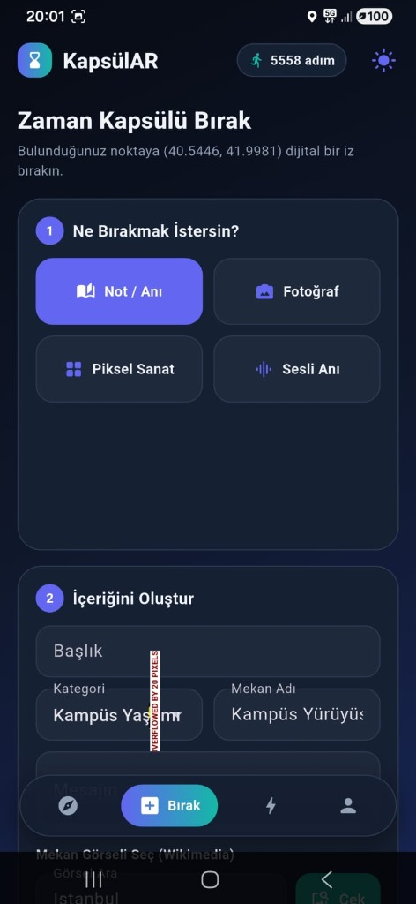

# KapsülAR — Konum Kilitli Dijital Zaman Kapsülü Sistemi

Web Tabanlı Artırılmış Gerçeklik (WebAR / PWA) ve Hibrit Konum Doğrulama mimarisi kullanılarak mekansal etkileşim ve fiziksel aktivite motivasyonunu artırmak amacıyla geliştirilen **Flutter (PWA + Mobil)** ve **ASP.NET Core (.NET 10) Uzamsal REST API** projesi.

---

## 1. Mimari Bileşenler

| Katman | Teknoloji | Konum |
|---|---|---|
| **İstemci (PWA & Mobil)** | Flutter (Material 3, `flutter_map`, `geolocator`, `sensors_plus`, WebRTC `getUserMedia`) | `flutter_app/` |
| **Sunucu & Uzamsal API** | ASP.NET Core (.NET 10) Minimal API | `backend/` |
| **Veritabanı Şeması & Yük Testi** | PostgreSQL + PostGIS (`GiST`, `SP-GiST`, `Geohash`) & `k6` | `backend/database/` |
| **Görsel Veri Kaynağı** | Wikimedia Commons & Wikipedia Geosearch API (Açık Lisanslı) | `WikimediaMediaService.cs` |

---

## 2. Öne Çıkan Özellikler ve Ekran Görüntüleri

### 1. Sade ve Anlaşılır 4 Sekmeli Arayüz (WIP User Interface)

- **Keşfet:** OpenStreetMap haritası, 15m WebAR tetikleme / 5m kilit halkaları, pusula yönelim göstergesi, Wikimedia görselli kapsül kartları, açık/karanlık tema desteği ve masaüstü/iç mekan testleri için **Yürüyüş Simülatörü (1.5 m/s)**.

| Keşfet (Açık Tema) | Keşfet (Karanlık Tema) |
| :---: | :---: |
|  |  |

- **Bırak:** Bulunulan GPS koordinatına Metin/Şifreli Not, Fotoğraf, **16×16 Piksel Sanat Tuvali**, Sesli Anı oluşturma ve **Wikimedia Commons'tan mekana uygun görsel çekme**.

| Zaman Kapsülü Bırak |
| :---: |
|  |

- **Aktivite & Profil (Araştırma Laboratuvarı):**
  - **Aktivite:** Günlük adım sayısı, yürünen mesafe (km), günlük hedef takibi ve açılan zaman kapsülleri arşivi.
  - **Profil & Araçlar:** Karanlık Tema anahtarı, Gerçek GPS Modu, varsayılan kilit yarıçapı (5 m / 10 m / 15 m) ve **Araştırma Laboratuvarı** erişimi:
    - **10.000 Noktalı Canlı Uzamsal İndeks Kıyaslaması:** İndekssiz tarama vs `Geohash` vs `SP-GiST (QuadTree)` vs `GiST (R-Tree/MBR)`.
    - **30 Saniyelik Hibrit Anti-Spoofing Testi:** Normal yürüyüş vs imkansız GPS sıçraması + sensör füzyonu tutarlılığı.
    - **SUS & TAM Değerlendirme Formu:** Anlık SUS puanı hesaplama (hedef > 75).

| Aktivite Sekmesi | Profil & Araştırma Laboratuvarı |
| :---: | :---: |
|  |  |

### 2. WebAR / AR Anti-Spoof Kilit Açma Akışı (Anı Hapı)

- Kapsüle 15m yaklaşıldığında harita radarı üzerinden ARCore/WebRTC kamera (`navigator.mediaDevices.getUserMedia`), IMU ve görsel çapa doğrulaması tetiklenir.
- **ORB inlier eşleşmesi**, **VIO yer değiştirme (`VIO Δ`)** ve **2B düzlem oranı (anti-spoofing)** kontrolleri geçildiğinde; sunucu tarafı son 30 saniyelik hız/ivme penceresini doğrular ve kapsülün şifresini çözer.

| 1. Harita Radarı & Menzil | 2. Görsel Çapa & Anti-Spoof Reddi | 3. Doğrulama & Şifre Çözme |
| :---: | :---: | :---: |
|  |  |  |

---

## 3. Çalıştırma Talimatları

### A. Backend API (.NET 10)
```powershell
cd backend
dotnet run
```
Sunucu varsayılan olarak `http://localhost:5088` adresinde çalışır.

### B. Flutter Uygulaması (PWA / Web veya Mobil)
```powershell
cd flutter_app
flutter pub get
flutter run -d chrome
```
> **Not:** Android emülatöründe `ApiClient` otomatik olarak `http://10.0.2.2:5088` adresini kullanır; gerekirse **Lab** sekmesinden API adresi değiştirilebilir.

### C. PostgreSQL + PostGIS ve k6 Yük Testi (Opsiyonel Üretim Ortamı)
- Şema ve indeksler: `backend/database/schema_postgis.sql`
- Yük testi: `k6 run backend/database/benchmark_k6.js`
