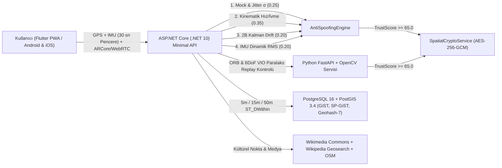
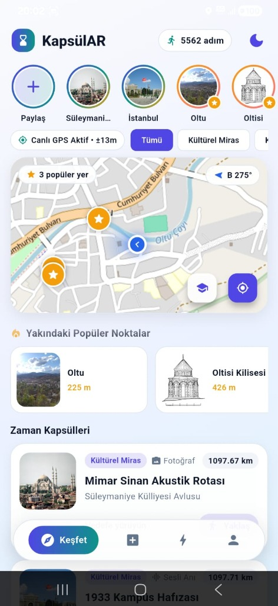
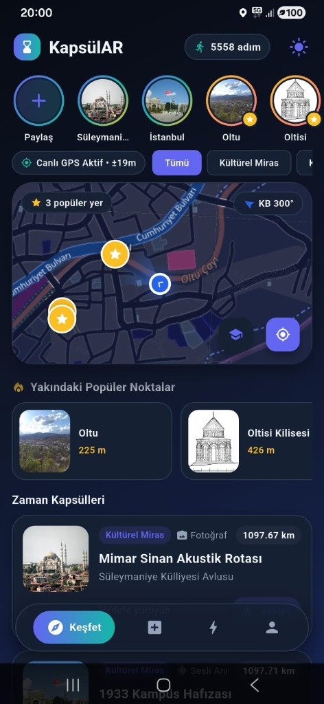
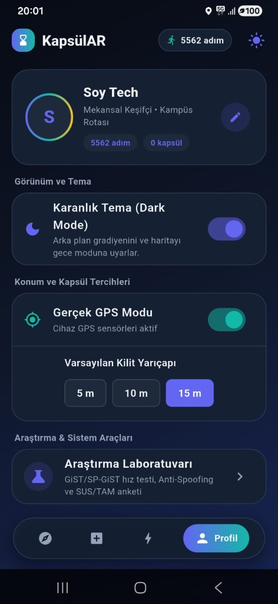
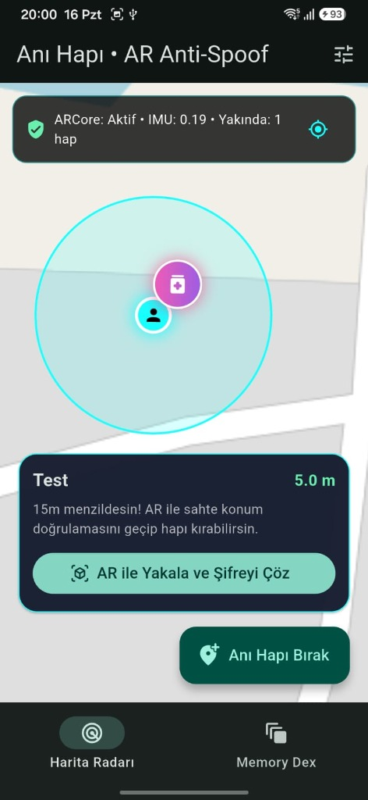
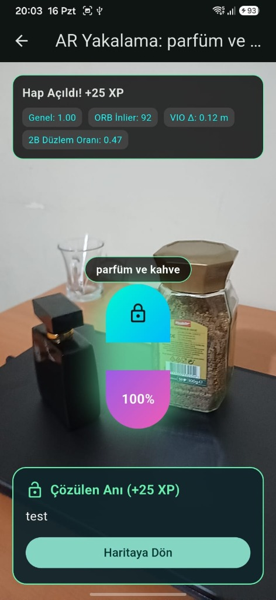

# KapsülAR — Konum Tabanlı Artırılmış Gerçeklik Sistemlerinde Çok Sensörlü Konum Sahteciliği Tespiti ve PostGIS Uzamsal İndeksleme Yapılarının Performans Analizi

[](backend/)
[](flutter_app/)
[](backend/database/schema_postgis.sql)
[](#-proje-k%C3%BCnyesi-t%C3%BCbi%CC%87tak-2209-a-format%C4%B1)

Konum tabanlı mobil ve web artırılmış gerçeklik (WebAR) uygulamalarındaki **sahte konum (GPS spoofing) enjeksiyonları** ile yüksek kullanıcı yoğunluğu altındaki **uzamsal veritabanı sorgu darboğazlarına** ölçülebilir çözümler sunan açık kaynaklı araştırma platformudur. Çok sensörlü anti-spoofing modeli, `AES-256-GCM` konum mühürlemesi ve PostGIS uzamsal indeksleme kıyaslama altyapısını konum-kilitli dijital zaman kapsülü test ortamı **KapsülAR** üzerinde birleştirir.

---

## Proje Künyesi (TÜBİTAK 2209-A Formatı)

| Alan | Bilgi |
| :--- | :--- |
| **Proje Başlığı** | Konum Tabanlı Artırılmış Gerçeklik Sistemlerinde Çok Sensörlü Konum Sahteciliği Tespiti ve PostGIS Uzamsal İndeksleme Yapılarının Performans Analizi: KapsülAR |
| **Araştırma Grubu** | **SOY Tech** |
| **Proje Yürütücüsü** | **Semih Beyaztaş** |
| **Araştırmacılar** | **Ozan Hasköy**, **Yusuf Çırak** |
| **Proje Danışmanı** | *[Danışman Unvanı Adı Soyadı - Üniversite / Bölüm]* |
| **Yürütüleceği Kurum** | *[Üniversite / Fakülte / Bölüm Adı]* |
| **Öngörülen Proje Süresi** | 12 Ay |
| **Talep Edilen Bütçe** | 8.000,00 TL |

---

## 1. Özet ve Anahtar Kelimeler

Salt istemcinin bildirdiği GNSS koordinatlarına güvenen konum tabanlı AR sistemleri; sahte konum (*GPS spoofing*) saldırılarına ve on binlerce coğrafi nokta altında `O(N)` uzamsal sorgu gecikmelerine karşı savunmasızdır. Bu çalışmada **KapsülAR** test yatağı üzerinde iki temel problem ele alınmaktadır:

1. **Çok Katmanlı Anti-Spoofing Modeli:** Android/iOS `Mock Location` bayrağı, sinyal doğruluk sapması, kinematik hız-ivme sınırları, yerel teğet düzlemde 2B Kalman filtresi, yerçekiminden arındırılmış IMU sensör füzyonu ve ORB / 6DoF VIO paralaks tabanlı görsel doğrulamayı birleştiren hibrit doğrulama motoru.
2. **PostGIS Uzamsal İndeksleme Analizi:** PostgreSQL 16 + PostGIS 3.4 üzerinde **İndekssiz (Sequential Scan)**, **Geohash-7**, **SP-GiST (QuadTree)** ve **GiST (R-Tree/MBR)** yapılarının `5 m`, `15 m` ve `50 m` yakınlık sorgularında **10.000–50.000** gerçek (Wikimedia/OSM) ve sentetik nokta ile `k6` (`50–200 VU`) yükü altında performans kıyaslaması.

**Anahtar Kelimeler:** *Uzamsal Veritabanları, PostGIS, GPS Sahteciliği Tespiti, Sensör Füzyonu, Artırılmış Gerçeklik (WebAR).*

---

## 2. Araştırma Soruları ve Ölçülebilir Hipotezler

| No | Araştırma Sorusu | Ölçülebilir Hipotez |
| :--- | :--- | :--- |
| **AS1** | IMU füzyonu, 2B Kalman filtresi ve AR görsel çapa/paralaks doğrulaması birleştirildiğinde konum sahteciliği ve 2B ekran replay saldırıları ne düzeyde ayırt edilebilir? | **H1 (Anti-Spoofing):** Hibrit model; Mock GPS, teleportation, hareketsiz IMU spoofing ve 2B ekran replay saldırılarını en az **%90 F1-skoru** ve **%92 doğrulukla** tespit edecek, yanlış pozitif oranını (**FPR**) **%5'in altında** tutacaktır. |
| **AS2** | 10.000–50.000 noktalı PostGIS ortamında farklı arama yarıçapları (`5/15/50 m`) ve eşzamanlı yüklerde İndekssiz, Geohash-7, SP-GiST ve GiST yapıları nasıl farklılaşır? | **H2 (Uzamsal Performans):** `GiST` ve `SP-GiST` indeksleri, `10.000+` noktada `5 m` yakınlık sorgularında indekssiz taramaya göre ortalama gecikmeyi en az **%75 düşürecek** ve `k6` altında **200 VU** yükünde `p95` yanıt süresini **50 ms'nin altında** tutacaktır. |
| **AS3** | Çok katmanlı güvenlik doğrulaması gerçek saha koşullarında kullanıcı deneyimini bozmadan yüksek kabul düzeyine ulaşabilir mi? | **H3 (Kullanılabilirlik):** **30 katılımcılı** 2 haftalık kampüs saha testinde ortalama **SUS** puanı **> 75** ve **TAM** algılanan kullanışlılık/kolaylık ortalaması 5 üzerinden **≥ 4,0** olacaktır. |

---

## 3. Bilimsel Yöntem ve Matematiksel Model

### 3.1. Sistem Mimarisi



### 3.2. Algoritmik Formülasyon

- **2B Sabit-Hız Kalman Süzgeci:** Yerel teğet düzlemde ($x$: doğu, $y$: kuzey) durum kestirimi ve inovasyon sapması ($e_k$):

$$\hat{x}_{k\vert{}k-1} = x_{k-1} + v_{x,k-1}\Delta t, \qquad \hat{y}_{k\vert{}k-1} = y_{k-1} + v_{y,k-1}\Delta t$$

$$K_k = \frac{P_{k\vert{}k-1}}{P_{k\vert{}k-1} + R_k}, \qquad R_k = 0.45 \cdot \mathrm{clamp}(\sigma_{\text{GPS}}, 2.5, 35.0)^2, \qquad e_k = \sqrt{(m_{x,k} - \hat{x}_{k\vert{}k-1})^2 + (m_{y,k} - \hat{y}_{k\vert{}k-1})^2}$$

- **4 Katmanlı Hibrit Güven Skoru ($T_{\text{trust}}$):** Son $30\text{ sn}$ telemetri penceresi üzerinden hesaplanır:

$$T_{\text{trust}} = 0.25\,L_1 + 0.35\,L_2 + 0.20\,L_3 + 0.20\,L_4$$

  - **$L_1$ (Sağlayıcı & Sinyal):** `IsMocked` bayrağı, $0.0\text{ m}$ sahte doğruluk ve doğruluk standart sapması ($\sigma_{\text{acc}} < 0.001$) kontrolü.
  - **$L_2$ (Kinematik Fizik):** Hız ($v_{\max} \le 8.5\text{ m/s}$ yaya sınırı, $v > 18.0\text{ m/s}$ sıçrama engeli) ve ivme ($a_{\max} \le 12.0\text{ m/s}^2$) kontrolü.
  - **$L_3$ (Kalman Drift):** İnovasyon sapması $e_k \le 12.0\text{ m}$ için tam puan, $e_k > 25.0\text{ m}$ için ret.
  - **$L_4$ (IMU & Görsel Paralaks):** İvmeölçer dinamik RMS enerjisi ($\text{RMS}_{\text{dyn}} < 0.045\text{ m/s}^2$ iken $> 10\text{ m}$ GPS hareketi varsa sabit-cihaz sahteciliği tespiti) ve ORB / 6DoF VIO paralaks düzlem oranı ile 2B ekran replay koruması.

- **Konuma Bağlı Anahtar Türetimi (`AES-256-GCM`):**

$$K_{\text{spatial}} = \mathrm{HMAC\text{-}SHA256}\big(K_{\text{master}}, \; \text{capsuleId} \parallel \mathrm{Geohash}_7(\phi,\lambda) \parallel \text{sector}_{30^\circ} \parallel \text{visualSig}\big)$$

- **SUS Puanlaması (Brooke, 1996):**

$$\text{SUS} = 2.5 \times \left( \sum_{i \in \{1,3,5,7,9\}} (a_i - 1) + \sum_{i \in \{2,4,6,8,10\}} (5 - a_i) \right)$$

### 3.3. Deneysel Tasarım ve İstatistiksel Plan

1. **Deney 1 — Uzamsal İndeksleme & Yük (`H2`):** Wikimedia/OSM gerçek noktaları ve sentetik dağılımlardan oluşan **10.000, 25.000 ve 50.000** noktalı veri setlerinde; İndekssiz, Geohash-7 (+8 komşu), SP-GiST ve GiST yapıları `5/15/50 m` yarıçaplarda ve `k6` (`50–200 VU`) yükünde `p50/p95/p99` gecikme, taranan aday sayısı ve `RPS` açısından test edilir.
2. **Deney 2 — Anti-Spoofing Doğruluk (`H1`):** **240 etiketli oturum** (`120` meşru yürüyüş + `30` Mock Location + `30` teleportation + `30` sabit IMU spoofing + `30` 2B ekran replay) üzerinde Accuracy, Precision, Recall, F1, FPR, FNR ve ROC-AUC hesaplanır.
3. **Deney 3 — Kampüs Saha & Kullanılabilirlik (`H3`):** 20 kampüs kapsül noktasında **N = 30** öğrenci (`38` davet) ile **2 haftalık** saha testi yürütülerek **SUS** ve **TAM** ölçekleri uygulanır.
4. **İstatistiksel Yöntemler:** **Shapiro–Wilk**, **Friedman + Holm–Bonferroni Wilcoxon**, **McNemar**, **Cronbach Alfa ($\alpha \ge 0,70$)** ve **Tek Örneklem t-Testi / Wilcoxon** ($p < 0,05$).

---

## 4. Proje Yönetimi (12 Ay)

### 4.1. Ekip Görev Dağılımı

| Rol | Üye | Sorumlu Olduğu İş Paketleri ve Görevler |
| :--- | :--- | :--- |
| **Proje Yürütücüsü** | **Semih Beyaztaş** | **İP2, İP3, İP6:** Sistem mimarisi koordinasyonu, 4 katmanlı Kalman/IMU anti-spoofing ve ORB/VIO paralaks algoritmaları, McNemar/ROC-AUC analizleri. |
| **Araştırmacı** | **Ozan Hasköy** | **İP1, İP4, İP6:** PostgreSQL + PostGIS (`GiST`, `SP-GiST`, `Geohash`) veritabanı tasarımı, `10.000–50.000` noktalı veri seti üretimi, `k6` yük testleri ve Friedman/Wilcoxon analizleri. |
| **Araştırmacı** | **Yusuf Çırak** | **İP1, İP3, İP5:** Flutter (PWA + Mobil) istemci ve WebAR/AR arayüz geliştirme, Wikimedia API entegrasyonu, `30` katılımcılı kampüs saha deneyi ve SUS/TAM veri toplama. |
| **Proje Danışmanı** | *[Unvan Ad Soyad]* | Bilimsel yöntem denetimi, Etik Kurul başvuru rehberliği ve akademik bildiri yayını. |

### 4.2. İş Paketleri ve Zaman Çizelgesi

| İP No | Faaliyet Özeti | Zaman | Başarı Ölçütü | Katkı (%) |
| :---: | :--- | :---: | :--- | :---: |
| **İP1** | Wikimedia/OSM ve `10k–50k` sentetik veri seti üretimi; PostGIS (`GiST`, `SP-GiST`, `Geohash-7`) kurulumu | 1–2. Ay | `50.000` nokta ve 3 indeksli şemanın %100 hatasız yüklenmesi | 15 |
| **İP2** | 4 katmanlı sensör füzyonu anti-spoofing motoru ve `120` saldırı senaryosu simülatörü | 2–4. Ay | `≥ %90` tespit duyarlılığı ve `< %5` yanlış pozitif oranı | 20 |
| **İP3** | WebAR / ARCore ORB görsel çapa, 6DoF VIO paralaks ve `AES-256-GCM` konum mührü entegrasyonu | 4–6. Ay | 2B ekran replay saldırılarında `≥ %90` engelleme | 20 |
| **İP4** | 4 indeks stratejisinin `5/15/50 m` yarıçap ve `k6` (`50–200 VU`) yük deneyleri | 6–8. Ay | `≥ %75` gecikme azalması ve `200 VU`'da `p95 < 50 ms` | 15 |
| **İP5** | 20 kampüs noktasında `N = 30` öğrenci ile 2 haftalık saha deneyi ve SUS/TAM anketleri | 8–10. Ay | 30 katılımcıdan eksiksiz saha logu ve anket verisi | 15 |
| **İP6** | İstatistiksel analizlerin tamamlanması, açık kaynak benchmark deposu ve bildiri yayını | 10–12. Ay | Tüm `H1–H3` hipotezlerinin testi ve GitHub benchmark yayını | 15 |

### 4.3. Bütçe Özeti (8.000,00 TL)

| Sıra | Bütçe Kalemi | Tür | Tutar (TL) |
| :---: | :--- | :---: | :---: |
| **1** | Bulut Test Sunucusu Kiralama (12 Ay × 350 TL/ay) | Hizmet Alımı | 4.200,00 TL |
| **2** | Alan Adı ve SSL/HTTPS Sertifika Hizmeti (12 Ay) | Hizmet Alımı | 900,00 TL |
| **3** | Kampüs Saha Testi QR/Çapa İşaretçi Baskısı ve Anket/Onam Kırtasiye Gideri | Sarf Malzeme | 1.400,00 TL |
| **4** | Ulusal Bilimsel Konferans Katılım Kaydı ve Poster Baskısı | Hizmet / Yayın | 1.500,00 TL |
| — | **GENEL TOPLAM** | — | **8.000,00 TL** |

### 4.4. Etik Kurul, KVKK ve ÜYZ Beyanı
- **Etik & KVKK:** Üniversite Etik Kurulu onayı ve katılımcılardan KVKK uyumlu aydınlatılmış onam alınacak; konum/adım verileri anonim `UUID` ile tutulacak, sunucuda ham kamera görüntüsü saklanmayacaktır.
- **ÜYZ Beyanı:** Üretken yapay zekâ araçları yalnızca taslak düzenleme ve yazılım prototipleme desteği için kullanılmış; tüm hipotezler, deney tasarımları ve kaynaklar ekip tarafından doğrulanmıştır.

---

## 5. Teknik Mimari, Ön Çalışma Bulguları ve Uygulama Ekranları

### 5.1. Teknoloji Yığını ve API Uç Noktaları

| Katman | Teknoloji / Dosya | İşlev |
| :--- | :--- | :--- |
| **İstemci** | Flutter (`Material 3`, `flutter_map`, `geolocator`, `sensors_plus`, WebRTC / ARCore) — `flutter_app/` | 30 sn GNSS penceresi, IMU örnekleme, pusula ve AR yakalama |
| **Backend & Kripto** | ASP.NET Core (`.NET 10`) Minimal API (`AntiSpoofingEngine.cs`, `SpatialCryptoService.cs`) — `backend/` | 4 katmanlı anti-spoofing ve `AES-256-GCM` konum mühürleme |
| **Görsel Analiz** | Python FastAPI + OpenCV & Native Android ARCore | ORB görsel çapa eşleştirme ve 6DoF VIO paralaks replay tespiti |
| **Veritabanı & Yük** | PostgreSQL 16 + PostGIS 3.4 (`schema_postgis.sql`), `SpatialIndexEngine.cs` & `k6` (`benchmark_k6.js`) | `GiST`, `SP-GiST`, `Geohash-7` kıyaslaması ve `50–200 VU` yük testi |

**Temel REST API Uçları (`backend/Program.cs`):** `GET/POST /api/capsules`, `POST /api/capsules/unlock`, `POST /api/antispoof/evaluate`, `GET /api/spatial/benchmark`, `GET /api/routes`, `POST /api/experiments/sus-tam`.

### 5.2. Ön Çalışma Doğrulama Bulguları
- Birim ve entegrasyon testleri başarıyla tamamlanmıştır (`pytest: 2/2 geçti`; `flutter test: 3/3 geçti`).
- Canlı cihaz testlerinde yanlış nesneye yöneltilen kamerada `ORB İnlier: 2 (< 8) / Genel Skor: 0,56` ile erişim engellenirken; gerçek referans sahnede `ORB İnlier: 92 / VIO Δ: 0,12 m / 2B Düzlem Oranı: 0,47 / Genel Skor: 1,00` ile `AES-256-GCM` anahtarı çözülmüştür.

### 5.3. Uygulama Ekranları (WIP User Interface)

| Keşfet (Açık Tema) | Keşfet (Karanlık Tema) | Zaman Kapsülü Bırak |
| :---: | :---: | :---: |
|  |  |  |

| Aktivite Sekmesi | Profil & SOY Tech Araştırma Laboratuvarı |
| :---: | :---: |
|  |  |

### 5.4. WebAR / AR Anti-Spoof Kilit Açma Akışı (Anı Hapı)

| 1. Harita Radarı & Menzil | 2. Görsel Çapa & Anti-Spoof Reddi | 3. Doğrulama & Şifre Çözme |
| :---: | :---: | :---: |
|  |  |  |

---

## 6. Çalıştırma ve Test Talimatları

```powershell
# 1. Backend API (.NET 10 -> http://localhost:5088)
cd backend && dotnet run

# 2. Flutter Uygulaması (PWA / Web veya Mobil)
cd flutter_app && flutter pub get && flutter test && flutter run -d chrome

# 3. PostGIS Şeması ve k6 Yük Testi (50-200 VU)
# Şema: backend/database/schema_postgis.sql
k6 run backend/database/benchmark_k6.js
```

---

## 7. Kaynakça

1. Althoff, T., White, R. W., & Horvitz, E. (2016). Influence of Pokémon Go on Physical Activity: Study and Implications. *JMIR*, 18(12), e315. DOI: `10.2196/jmir.6759`
2. Aref, W. G., & Ilyas, I. F. (2001). SP-GiST: An extensible database index for supporting space partitioning trees. *Journal of Intelligent Information Systems*, 17(2–3), 215–240. DOI: `10.1023/A:1012809914301`
3. Bangor, A., Kortum, P. T., & Miller, J. T. (2008). An Empirical Evaluation of the System Usability Scale. *IJHCI*, 24(6), 574–594. DOI: `10.1080/10447310802205776`
4. Ceccato, M., Formaggio, F., Laurenti, N., & Tomasin, S. (2021). Generalized Likelihood Ratio Test for GNSS Spoofing Detection in Devices with IMU. *IEEE TIFS*, 16, 3496–3509. DOI: `10.1109/TIFS.2021.3083414`
5. Davis, F. D. (1989). Perceived Usefulness, Perceived Ease of Use, and User Acceptance of Information Technology. *MIS Quarterly*, 13(3), 319–340. DOI: `10.2307/249008`
6. Guttman, A. (1984). R-trees: A dynamic index structure for spatial searching. *ACM SIGMOD*, 47–57. DOI: `10.1145/602259.602266`
7. Hellerstein, J. M., Naughton, J. F., & Pfeffer, A. (1995). Generalized Search Trees for Database Systems. *VLDB*, 562–573. Erişim: `https://www.vldb.org/conf/1995/P562.PDF`
8. Jing, Y., et al. (2022). Integrity Monitoring of GNSS/INS Based Positioning Systems for Autonomous Vehicles. *IEEE TITS*. DOI: `10.1109/TITS.2022.3179313`
9. Liu, Y., Li, S., Fu, Q., Liu, Z., & Zhou, Q. (2019). Analysis of Kalman Filter Innovation-Based GNSS Spoofing Detection Method for INS/GNSS Integrated Navigation System. *IEEE Sensors Journal*, 19(13), 5167–5178. DOI: `10.1109/JSEN.2019.2902178`
10. Rublee, E., Rabaud, V., Konolige, K., & Bradski, G. (2011). ORB: An efficient alternative to SIFT or SURF. *IEEE ICCV*, 2564–2571. DOI: `10.1109/ICCV.2011.6126544`
