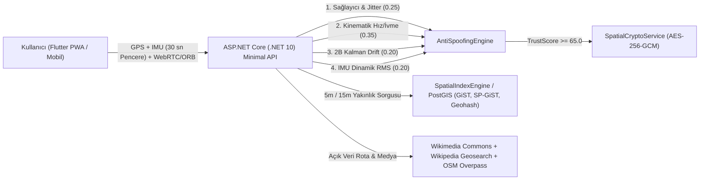

# KapsülAR — Küçük Şehir/İlçe ve Üniversite Odaklı Sosyal Yürüyüş Rotaları ve WebAR Zaman Kapsülü Sistemi

[](backend/)
[](flutter_app/)
[](backend/database/schema_postgis.sql)
[](#-proje-k%C3%BCnyesi-t%C3%BCbi%CC%87tak-2209-a-format%C4%B1)

Küçük şehir ve ilçelerde yaşayan halk ile üniversite öğrencilerinin fiziksel hareketsizlik, sosyalleşememe ve *"çevrede gezilecek/yürünecek yer yok"* algısından kaynaklanan umutsuzluk döngüsünü azaltmak amacıyla geliştirilen; **ham kültürel/doğa yürüyüş rotalarını** (Likya Yolu, Frig Vadisi, ilçe/kampüs hatları), **sıfırdan oluşturulup topluluk tarafından puanlanabilen rotaları**, **otomatik yerel rota öneri motorunu** ve **4 katmanlı anti-spoofing korumalı WebAR zaman kapsüllerini** bir araya getiren açık kaynaklı araştırma ve uygulama platformudur.

---

## Proje Künyesi (TÜBİTAK 2209-A Formatı)

| Alan | Bilgi |
| :--- | :--- |
| **Proje Başlığı** | Küçük Şehir ve Üniversite Yerleşkelerinde Fiziksel Aktivite ile Sosyal Etkileşimi Artırmaya Yönelik Ham/Topluluk Yürüyüş Rotaları ve Hibrit Konum Doğrulamalı WebAR Zaman Kapsülü Sisteminin Geliştirilmesi |
| **Araştırma Grubu** | **SOY Tech** |
| **Proje Yürütücüsü** | **Yusuf Çırak** *(Tek Yürütücü)* |
| **Araştırmacılar (Proje Ortakları)** | **Semih Beyaztaş**, **Ozan Hasköy** |
| **Akademik Danışman** | *[Üniversite / Bölüm Danışmanı Unvan Ad Soyad]* |
| **Öngörülen Proje Süresi** | 12 Ay |
| **Çalışma Alanı** | Bilgisayar Mühendisliği, Mekânsal Veritabanları, Mobil İnsan–Bilgisayar Etkileşimi (HCI) ve Konum Güvenliği |

---

## 1. Özet ve Anahtar Kelimeler

Büyükşehir dışındaki küçük şehir ve ilçelerde yaşayan gençler, üniversite öğrencileri ve yerel halk; yapılandırılmış sosyal yürüyüş rotaları ile keşfedilebilir açık alan etkinliklerinin eksikliği nedeniyle yüksek düzeyde fiziksel hareketsizlik ve sosyal izolasyon riski yaşamaktadır. Standart adım sayar ve harita uygulamaları yalnızca pasif mesafe kaydı tutmakta; kullanıcıyı çevresindeki potansiyel sosyalleşme noktalarına yönlendiren, topluluk tarafından üretilip değerlendirilebilen ve konum sahteciliğine (*GPS spoofing*) karşı dirençli bir etkileşim mimarisi sunmamaktadır.

Bu projede;
1. **Likya Yolu** ve **Frig Vadisi** gibi bilinen uzun/kısa mesafe parkurların **ham GPS duraklı rotalarını** ve küçük ilçelerdeki kampüs/park hatlarını sunan,
2. Kullanıcıların harita üzerinden dokunarak **0'dan yürüyüş rotası** çizebildiği veya OpenStreetMap Overpass + Wikipedia Geosearch açık verileriyle bulunduğu noktadan **otomatik yerel yürüyüş döngüsü** üretebildiği,
3. Oluşturulan ve ham rotaların diğer kullanıcılar tarafından **1–5 yıldız**, **yorum** ve **yürüyüş sonrası moral/sosyalleşme puanı** ile değerlendirilebildiği,
4. Rota duraklarına `Geohash` + görsel imza tabanlı **AES-256-GCM** konumsal mühürlü ve **4 katmanlı hibrit anti-spoofing** korumalı **WebAR zaman kapsüllerinin** bırakılabildiği bütünleşik bir yazılım mimarisi geliştirilmekte ve 4 haftalık yarı-deneysel saha çalışmasıyla doğrulanmaktadır.

**Anahtar Kelimeler:** *Konum Tabanlı Artırılmış Gerçeklik (WebAR), Sosyal Yürüyüş Rotaları, Fiziksel Aktivite ve İyi Oluş, Uzamsal İndeksleme (PostGIS GiST/SP-GiST), GPS Anti-Spoofing, 2B Kalman Filtresi, AES-256-GCM.*

---

## 2. Amaç, Problem Tanımı ve Özgün Değer

### 2.1. Toplumsal ve Bilimsel Problem
- **Küçük Şehir/İlçelerde Hareketsizlik ve Sosyal İzolasyon:** Taşra üniversite yerleşkeleri ve küçük ilçelerde öğrenciler ile yerel halk için düşük maliyetli, erişilebilir ve sürdürülebilir açık alan sosyalleşme mekanizmaları yetersizdir. *"Gezilecek yer yok"* algısı ev/yurt içi ekran süresini artırmakta, fiziksel hareketliliği ve psikolojik iyi oluşu olumsuz etkilemektedir.
- **Literatür ve Mevcut Sistemlerdeki Boşluk:**
  - *Oyunlaştırılmış LBAR uygulamaları* (Althoff vd., 2016) büyük kent merkezlerinde yoğun nokta üretirken küçük ilçelerde içerik kıtlığı yaşamaktadır.
  - *Klasik fitness uygulamaları* topluluk içi rota üretimi, akran puanlaması ve fiziksel varlık doğrulaması içermediğinden *Mock GPS* yazılımlarıyla kolayca suistimal edilebilmektedir.
  - *Yüksek yoğunluklu konum sorguları*, uygun uzamsal indeksleme olmadan mobil istemcilerde gecikmeye (`O(N)`) yol açmaktadır.

### 2.2. Projenin Özgün Katkıları
1. **Üç Katmanlı Sosyal Rota Ekosistemi:** Ham rotalar (`Ham Rota`), kullanıcıların harita üzerinden sıfırdan ürettiği rotalar (`Topluluk Rotası`) ve veri seyrek küçük ilçelerde bile otomatik çevre döngüsü üreten motor (`Otomatik Çevre Rotası`) tek bir harita katmanında birleşir.
2. **Matematiksel ve Sensör Tabanlı Konum Güvenliği:** Sunucu tarafında çalışan 30 saniyelik kayan telemetri penceresi; işletim sistemi sahtecilik bayraklarını, yaya kinematiğini, 2B Kalman kestirim inovasyonunu ve ivmeölçer/jiroskop IMU dinamik enerjisini birleştirerek konum sahteciliğini engeller.
3. **Konuma Bağlı Kriptografik Mühürleme (Geo-Encryption):** Kapsül metinleri yalnızca sunucu tarafında saklanmakla kalmaz; anahtar türetimi 7 karakterlik `Geohash` ve görsel yer işareti imzasına bağlanarak **AES-256-GCM** ile şifrelenir (Scott & Denning, 2003; NIST SP 800-38D).
4. **Çift Boyutlu Etki Ölçümü (Fiziksel + Psikososyal):** Sistem hem adım/mesafe/rota tamamlama verilerini hem de yürüyüş sonrası **1–5 Moral & Sosyalleşme İsteği**, **SUS** ve **TAM** metriklerini uygulama içi araştırma laboratuvarında toplar.

---

## 3. Araştırma Soruları ve Sayısal Hipotezler

| No | Araştırma Sorusu | Test Edilebilir Sayısal Hipotez |
| :--- | :--- | :--- |
| **AS1** | PostGIS uzamsal indeksleme yöntemleri (`Geohash`, `SP-GiST`, `GiST`) 10.000 noktalı 5 m yakınlık sorgularında gecikmeyi ve aday tarama maliyetini nasıl değiştirir? | **H1:** `GiST (R-Tree)` ve `Geohash` ön filtreleme, indekssiz sıralı taramaya kıyasla taranan aday nokta sayısını **≥ %90** azaltacak ve `k6` altında **200 eşzamanlı kullanıcı (VU)** yükünde **P95 < 50 ms** yanıt süresi sağlayacaktır. |
| **AS2** | 4 katmanlı kinematik + 2B Kalman + IMU sensör füzyonu mimarisi sahte GPS saldırılarını ne düzeyde ayırabilir? | **H2:** Hibrit anti-spoofing motoru, sentetik ve Mock GPS sıçrama/durağan-IMU saldırılarında **≥ %95** tespit doğruluğu ve gerçek yaya yürüyüşlerinde **≤ %5** yanlış ret oranı elde edecektir. |
| **AS3** | Ham/topluluk yürüyüş rotaları, puanlama ve WebAR kapsülleri küçük ilçe ve kampüs kullanıcılarında aktivite ile iyi oluşu artırır mı? | **H3:** 4 haftalık saha çalışmasında deney grubunun haftalık ortalama adım sayısı kontrol grubuna göre **≥ %25** daha yüksek olacak; yürüyüş sonrası iyi oluş/sosyalleşme puanında istatistiksel olarak anlamlı (**p < 0.05**) artış gözlenecektir. |
| **AS4** | Geliştirilen Flutter PWA/mobil arayüzü hedef kitle tarafından kullanılabilir ve benimsenebilir bulunur mu? | **H4:** Katılımcıların Sistem Kullanılabilirlik Ölçeği (SUS) ortalaması **≥ 75 / 100** ve Teknoloji Kabul Modeli (TAM) algılanan fayda/kolaylık puanları **≥ 4.0 / 5.0** olacaktır. |

---

## 4. Bilimsel Yöntem, Matematiksel Model ve İstatistiksel Plan

### 4.1. Sistem Mimarisi ve Doğrulama Akışı



### 4.2. Algoritmik ve Matematiksel Formülasyon

#### A. 2B Sabit-Hız Kalman Süzgeci ve İnovasyon Sapması
Kentsel/ilçe GPS çoklu yansıma (5–20 m) gürültüsünü süzmek ve ani sahte konum sıçramalarını ölçmek için yerel teğet düzlemde ($x$: doğu, $y$: kuzey metre cinsinden) durum kestirimi uygulanır:

$$\hat{x}_{k|k-1} = x_{k-1} + v_{x,k-1}\Delta t, \qquad \hat{y}_{k|k-1} = y_{k-1} + v_{y,k-1}\Delta t$$

$$K_k = \frac{P_{k|k-1}}{P_{k|k-1} + R_k}, \qquad R_k = 0.45 \cdot \mathrm{clamp}(\sigma_{\text{GPS}}, 2.5, 35.0)^2$$

$$e_k = \sqrt{(m_{x,k} - \hat{x}_{k|k-1})^2 + (m_{y,k} - \hat{y}_{k|k-1})^2}$$

Burada $e_k$ (`KalmanInnovationMeters`) ani teleportasyon/sahte konum enjeksiyonlarında eşik değeri ($e_k > 25.0\text{ m}$) aşarak Katman 3 alarmı üretir.

#### B. 4 Katmanlı Hibrit Güven Skoru ($T_{\text{trust}}$)
Son $30\text{ sn}$ telemetri penceresi üzerinden hesaplanan bileşik güven skoru:

$$T_{\text{trust}} = 0.25\,L_1 + 0.35\,L_2 + 0.20\,L_3 + 0.20\,L_4$$

- **$L_1$ (Sağlayıcı & Sinyal Bütünlüğü):** `IsMocked` bayrağı, $0.0\text{ m}$ sahte doğruluk ve doğruluk standart sapması ($\sigma_{\text{acc}} < 0.001$) kontrolü.
- **$L_2$ (Kinematik Fizik):** Haversine mesafesinden türetilen hız ($v_{\max} \le 8.5\text{ m/s}$ yaya sınırı, $v > 18.0\text{ m/s}$ imkansız sıçrama) ve ivme ($a_{\max} \le 12.0\text{ m/s}^2$).
- **$L_3$ (Kalman Drift Filtresi):** İnovasyon sapması $e_k \le 12.0\text{ m}$ için tam puan, $e_k > 25.0\text{ m}$ için ret.
- **$L_4$ (IMU Sensör Füzyonu):** Yerçekimi ortalamasından arındırılmış ivmeölçer dinamik RMS enerjisi ($\text{RMS}_{\text{dyn}} < 0.045\text{ m/s}^2$ iken $> 10\text{ m}$ GPS hareketi varsa sahte hareket tespiti).

#### C. Konuma Bağlı Anahtar Türetimi (`AES-256-GCM`)
$$K_{\text{spatial}} = \mathrm{HMAC\text{-}SHA256}\big(K_{\text{master}}, \; \text{capsuleId} \parallel \mathrm{Geohash}_7(\phi,\lambda) \parallel \text{visualSig}\big)$$

Şifreleme 12 baytlık rastgele `nonce`, 16 baytlık bütünlük etiketi (`tag`) ve `AAD` ile doğrulanır.

#### D. Rota Kinematik Tahmini ve SUS Puanlaması
- Rota süresi ve adım tahmini ortalama $4.2\text{ km/sa}$ yürüyüş hızı ve $0.72\text{ m}$ adım uzunluğu üzerinden hesaplanır: $\text{Adım} = \text{round}(D_{\text{metre}} / 0.72)$.
- 10 maddelik SUS puanı (Brooke, 1996):

$$\text{SUS} = 2.5 \times \left( \sum_{i \in \{1,3,5,7,9\}} (a_i - 1) + \sum_{i \in \{2,4,6,8,10\}} (5 - a_i) \right)$$

### 4.3. Deneysel Tasarım ve İstatistiksel Analiz Planı

1. **Aşama 1 — Uzamsal İndeksleme & Yük Deneyi:** `SpatialIndexEngine.cs` ve `schema_postgis.sql` üzerinde `N = 10.000` sentetik nokta, `r = 5.0 m` yarıçap ve `100` sorgu yinelemesiyle `(M0)` İndekssiz, `(M1)` Geohash, `(M2)` SP-GiST (QuadTree) ve `(M3)` GiST (R-Tree/MBR) karşılaştırılır; `k6` (`benchmark_k6.js`) ile `200 VU` yükünde `P95 < 50 ms` doğrulanır.
2. **Aşama 2 — Anti-Spoofing Doğruluk Deneyi:** Normal yürüyüş, sabit cihazda sahte GPS ve ani sıçrama sınıflarından oluşan **120 senaryo oturumu** üzerinde Precision, Recall, F1 ve yanlış pozitif oranı (FPR) raporlanır.
3. **Aşama 3 — Yarı-Deneysel Saha Çalışması (`n = 40`):** Küçük ilçe sakinleri ve üniversite öğrencilerinden oluşan **40 katılımcı** (büyük etki büyüklüğü $d \ge 0.80$, $\alpha = 0.05$, güç $1-\beta \approx 0.80$ varsayımıyla grup başına 20 kişi; olası %20 kayba karşı 48 yedek kayıt):
   - **Deney Grubu (`n = 20`):** KapsülAR (Ham rotalar + 0'dan rota oluşturma + topluluk puanlama + WebAR kapsülleri).
   - **Kontrol Grubu (`n = 20`):** Sosyal rota/puanlama ve WebAR olmadan standart harita ve adım takibi (4 hafta).
4. **İstatistiksel Yöntemler:** Normallik için **Shapiro–Wilk**; gruplar arası karşılaştırmada **Bağımsız Örneklem t-Testi / Mann–Whitney U**; grup içi ön-test/son-test için **Eşli t-Testi / Wilcoxon İşaretli Sıralar Testi**; M0–M3 indeks karşılaştırmasında **Friedman Testi + Holm–Bonferroni** düzeltmesi ve etki büyüklüğü için **Cohen's *d* / *r*** kullanılır ($\alpha = 0.05$).

---

## 5. Proje Yönetimi (TÜBİTAK 2209-A Prosedürleri)

### 5.1. Ekip Görev Dağılımı
| Rol | Üye | Sorumluluklar |
| :--- | :--- | :--- |
| **Proje Yürütücüsü** | **Yusuf Çırak** | Genel koordinasyon, ASP.NET Core & PostGIS uzamsal servisler, anti-spoofing/kripto modülü, istatistiksel analiz ve TÜBİTAK raporlama |
| **Araştırmacı (Proje Ortağı)** | **Semih Beyaztaş** | Flutter mobil/PWA arayüzü, 0'dan rota çizim bileşeni, harita katmanları, SUS/TAM ve iyi oluş saha veri toplama |
| **Araştırmacı (Proje Ortağı)** | **Ozan Hasköy** | Ham rota GPS veri doğrulama (Likya/Frig/ilçe hatları), WebAR görsel doğrulama testleri, `k6` yük testi ve saha pilot organizasyonu |
| **Akademik Danışman** | *[Unvan Ad Soyad]* | Bilimsel yöntem denetimi, Etik Kurul başvuru rehberliği ve akademik bildiri yayını |

### 5.2. İş Paketleri (İP), İş-Zaman Çizelgesi (12 Ay) ve Başarı Ölçütleri

| İP No | İş Paketi Adı | Süre (Ay) | Sorumlu | Başarı Ölçütü (%) |
| :---: | :--- | :---: | :--- | :--- |
| **İP1** | Literatür Taraması, Etik Kurul Başvurusu ve Ham Rota Derleme | 1 – 2 | Yusuf Çırak, Ozan Hasköy | Etik Kurul onayı alınması; ≥ 4 ham rota GPS doğrulaması (%100) |
| **İP2** | PostGIS Uzamsal İndeksleme & Anti-Spoofing Optimizasyonu | 3 – 4 | Yusuf Çırak | `10.000` noktada `P95 < 50 ms`; spoof engelleme `≥ %95` (%100) |
| **İP3** | İstemci Geliştirme (0'dan Rota, Puanlama, Otomatik Öneri & WebAR) | 5 – 7 | Semih Beyaztaş | Birim/entegrasyon testlerinin hatasız geçmesi; Android/Web çalışırlık (%100) |
| **İP4** | Yarı-Deneysel Saha Çalışması (Küçük İlçe & Kampüs, `n = 40`) | 8 – 10 | Semih Beyaztaş, Ozan Hasköy | 4 haftalık takipte `n ≥ 40` katılımcıdan `≥ %90` tam veri toplanması |
| **İP5** | İstatistiksel Veri Analizi ve Hipotez Doğrulama (`H1–H4`) | 10 – 11 | Yusuf Çırak | Shapiro–Wilk, Mann–Whitney/t-testi, Friedman analizlerinin tamamlanması (%100) |
| **İP6** | TÜBİTAK Sonuç Raporu, Bildiri ve Açık Kaynak Yayın | 11 – 12 | Tüm Ekip | TÜBİTAK final raporu teslimi ve ≥ 1 konferans bildirisi başvurusu (%100) |

### 5.3. Risk Yönetimi ve B Planları

| Risk Tanımı | Etki | Olasılık | Önlem ve B Planı |
| :--- | :---: | :---: | :--- |
| **Saha çalışmasında katılımcı ayrılması (`n < 40`)** | Yüksek | Orta | %20 yedek (`48` katılımcı) ile başlanır; öğrenci kulüpleri ve ilçe topluluklarıyla düzenli yürüyüş günleri planlanır. |
| **Kırsal/ilçede internet veya Overpass API kesintisi** | Orta | Orta | İstemcide `SharedPreferences` yerel önbelleği, gömülü ham rotalar ve çevrimdışı döngü rota üreticisi devreye girer. |
| **Düşük ışıkta WebAR görsel eşleşme kaybı** | Orta | Düşük | Görsel çapa skoru düştüğünde 30 sn Kalman + IMU penceresi ve pusula 30° sektör doğrulaması birincil güvenlik katmanı olarak sürdürülür. |
| **Kentsel/vadi GPS multipath sapması** | Orta | Orta | 2B Kalman süzgeci ve `5–15 m` yapılandırılabilir kilit yarıçapı ile hatalı kilit retleri önlenir. |

### 5.4. Bütçe Planlaması (TÜBİTAK 2209-A Üst Sınırı: 12.000 TL)

| Bütçe Kalemi | Miktar | Tutar (TL) | Teknik / Bilimsel Gerekçe |
| :--- | :---: | :---: | :--- |
| **Bulut Test Sunucusu (VPS + PostgreSQL/PostGIS + Alan Adı/SSL, 12 Ay)** | 1 Paket | 4.800 TL | Saha deneyi (`n = 40`) boyunca PostGIS uzamsal sorgularının, telemetri doğrulamalarının ve `k6` yük testlerinin yürütülmesi |
| **Saha Testi QR/Referans Tabela ve Basılı Bilgilendirme Materyali** | 40 Set | 1.900 TL | Pilot ilçe ve kampüs rota duraklarında görsel çapa testleri, gönüllü onam formları ve yönlendirme etiketleri |
| **Taşınabilir Güç Kaynağı (Powerbank) ve Saha Test Telefon Tutucu** | 3 Adet | 2.700 TL | 4 haftalık açık alan GPS/IMU/WebAR ölçümlerinde cihaz pil kesintisini önleme ve sabit kamera açısı sağlama |
| **Akademik Bildiri Katılım / Kırtasiye ve Sarf Giderleri** | 1 Kalem | 2.000 TL | İP6 kapsamında ulusal mühendislik/öğrenci kongresinde sonuçların sunulması ve anket çıktıları |
| **TOPLAM** | — | **11.400 TL** | *TÜBİTAK 2209-A 12.000 TL bütçe üst sınırına uygundur.* |

### 5.5. Etik Kurul, KVKK, Açık Lisans ve ÜYZ Beyanı
- **Etik Kurul & KVKK:** Saha çalışması öncesi üniversite Etik Kurulu onayı alınır; tüm katılımcılardan bilgilendirilmiş gönüllü onam formu toplanır. Konum telemetrisi yalnızca 30 saniyelik geçici doğrulama penceresinde işlenir; kalıcı kayıtlarda gerçek kimlik yerine anonim `userId` tutulur.
- **Telif & Açık Lisans:** Tüm mekân görselleri ve POI verileri açık lisanslı Wikimedia Commons, Wikipedia Geosearch ve OpenStreetMap Overpass API kaynaklarından çekilir.
- **Üretken Yapay Zekâ (ÜYZ) Beyanı:** Mimari inceleme ve dokümantasyon düzenlemelerinde üretken yapay zekâ araçlarından destek alınmış; tüm kod, algoritma parametreleri, kaynakça DOI'leri ve deney planı proje ekibi tarafından doğrulanmıştır.

---

## 6. Yaygın Etki

- **Toplumsal ve Sağlık Etkisi:** Küçük ilçe ve taşra üniversitelerindeki gençlerin *"gezilecek yer yok"* algısını kırarak açık havada yürümesini, kendi rotalarını üretip puanlamasını ve akranlarıyla sosyalleşmesini destekler.
- **Bilimsel Çıktı:** Uzamsal indeksleme kıyaslaması (`GiST` vs `SP-GiST` vs `Geohash`), 4 katmanlı anti-spoofing doğruluk analizi ve saha aktivite/iyi oluş verileri ulusal/uluslararası bir konferans bildirisine dönüştürülür.
- **Açık Kaynak Katkısı:** Kod tabanı, PostGIS şeması, `k6` yük senaryoları ve anonimleştirilmiş performans/rota veri seti GitHub üzerinden açık erişime sunulur.

---

## 7. Teknik Mimari, API Uçları ve Uygulama Ekranları

### 7.1. Mimari Bileşenler

| Katman | Teknoloji | Konum |
|---|---|---|
| **İstemci (PWA & Mobil)** | Flutter (Material 3, `flutter_map`, `geolocator`, `sensors_plus`, WebRTC `getUserMedia`) | `flutter_app/` |
| **Sunucu & Uzamsal API** | ASP.NET Core (.NET 10) Minimal API | `backend/` |
| **Veritabanı Şeması & Yük Testi** | PostgreSQL + PostGIS (`GiST`, `SP-GiST`, `Geohash`) & `k6` | `backend/database/` |
| **Görsel & Mekânsal Açık Veri** | Wikimedia Commons, Wikipedia Geosearch & OpenStreetMap Overpass API | `WikimediaMediaService.cs` |

### 7.2. REST API Uç Noktaları (`backend/Program.cs`)

| Metot & Yol | İşlev |
| :--- | :--- |
| `GET /api/capsules` | Kullanıcının koordinatına göre yakın kapsülleri mesafe ve WebAR menzil bilgisiyle listeler |
| `POST /api/capsules` | Yeni kapsül oluşturur ve içeriği `Geohash` + görsel imzaya bağlı `AES-256-GCM` ile mühürler |
| `POST /api/capsules/unlock` | 30 sn telemetri penceresi + 4 katmanlı anti-spoofing + görsel eşleşme sonrası şifreyi çözer |
| `POST /api/antispoof/evaluate` | Gönderilen telemetri penceresini 4 katmanda test edip `TrustScore` raporu döner |
| `GET /api/spatial/benchmark` | `10.000` sentetik nokta üzerinde İndekssiz / Geohash / SP-GiST / GiST benchmark çalıştırır |
| `GET /api/routes` | Ham rotaları (Likya, Frig, Oltu vb.) ve kullanıcı tarafından 0'dan çizilen rotaları getirir |
| `GET /api/routes/suggest` | Bulunulan konumdan OSM/Wikipedia POI'leri veya yerel yürüyüş çemberiyle otomatik rota üretir |
| `POST /api/routes` | Haritadan seçilen duraklarla 0'dan yeni yürüyüş rotası kaydeder |
| `POST /api/routes/{id}/rate` | Diğer kullanıcıların 1–5 yıldız, yorum ve moral/sosyalleşme puanı eklemesini sağlar |
| `POST /api/routes/{id}/complete` | Rota tamamlama, adım/mesafe ve iyi oluş kaydını işler |
| `POST /api/experiments/sus-tam` & `wellbeing` | SUS, TAM ve yürüyüş sonrası iyi oluş/sosyalleşme araştırma verilerini toplar |

### 7.3. Sade ve Anlaşılır 4 Sekmeli Arayüz (WIP User Interface)

- **Keşfet (Harita + Yürüyüş Rotaları + Kapsüller):** OpenStreetMap haritası, 15 m WebAR tetikleme / 5 m kilit halkaları, pusula yönelim konisi, `Polyline` rota çizimi, **`Rota Öner`**, **`0'dan Çiz`**, rota puanlama/yorum penceresi ve **Yürüyüş Simülatörü (1.5 m/s)**.

| Keşfet (Açık Tema) | Keşfet (Karanlık Tema) |
| :---: | :---: |
|  |  |

- **Bırak / Oluştur (Zaman Kapsülü & 0'dan Rota Oluşturucu):** Bulunulan GPS koordinatına Metin/Şifreli Not, Fotoğraf, **16×16 Piksel Sanat Tuvali**, Sesli Anı bırakma veya haritaya dokunarak **0'dan yürüyüş rotası** oluşturma.

| Zaman Kapsülü Bırak |
| :---: |
|  |

- **Aktivite & Profil (İyi Oluş Ölçümü & Araştırma Laboratuvarı):** Günlük adım/rota/iyi oluş takibi (1–5 moral & sosyalleşme check-in), **10.000 Noktalı Uzamsal İndeks Kıyaslaması**, **30 Saniyelik Hibrit Anti-Spoofing Testi** ve **SUS & TAM Değerlendirme Formu**.

| Aktivite Sekmesi | Profil & Araştırma Laboratuvarı |
| :---: | :---: |
|  |  |

### 7.4. WebAR / AR Anti-Spoof Kilit Açma Akışı (Anı Hapı)

- Kapsüle 15 m yaklaşıldığında harita radarı üzerinden WebRTC kamera (`navigator.mediaDevices.getUserMedia`), IMU ve görsel çapa doğrulaması tetiklenir.
- **ORB inlier eşleşmesi**, **VIO yer değiştirme (`VIO Δ`)** ve **2B düzlem oranı (anti-spoofing)** kontrolleri geçildiğinde; sunucu tarafı son 30 saniyelik 4 katmanlı doğrulamayı onaylar ve `AES-256-GCM` mühürlü kapsülü çözer.

| 1. Harita Radarı & Menzil | 2. Görsel Çapa & Anti-Spoof Reddi | 3. Doğrulama & Şifre Çözme |
| :---: | :---: | :---: |
|  |  |  |

---

## 8. Çalıştırma ve Test Talimatları

### A. Backend API (.NET 10)
```powershell
cd backend
dotnet run
```
Sunucu varsayılan olarak `http://localhost:5088` adresinde çalışır.

### B. Flutter Uygulaması (PWA / Web veya Mobil)
```powershell
cd flutter_app
flutter pub get
flutter test
flutter run -d chrome
```
> **Not:** Android emülatöründe `ApiClient` otomatik olarak `http://10.0.2.2:5088` adresini kullanır; gerekirse **Lab** sekmesinden API adresi değiştirilebilir.

### C. PostgreSQL + PostGIS ve k6 Yük Testi (Opsiyonel Üretim Ortamı)
- Şema ve indeksler: `backend/database/schema_postgis.sql`
- Yük testi: `k6 run backend/database/benchmark_k6.js`

---

## 9. Kaynakça

1. Althoff, T., White, R. W., & Horvitz, E. (2016). Influence of Pokémon Go on Physical Activity: Study and Implications. *Journal of Medical Internet Research*, 18(12), e315. DOI: `10.2196/jmir.6759`
2. Mazeas, A., Duclos, M., Pereira, B., & Chalabaev, A. (2022). Evaluating the Effectiveness of Gamification on Physical Activity: Systematic Review and Meta-analysis of Randomized Controlled Trials. *Journal of Medical Internet Research*, 24(1), e26779. DOI: `10.2196/26779`
3. Tzima, S., Styliaras, G., Bassounas, A., & Tzima, M. (2023). Location-Based Augmented Reality for Cultural Heritage Education: Creating Educational, Gamified Location-Based AR Applications for the Prehistoric Lake Settlement of Dispilio. *Sensors*, 23(10), 4963. DOI: `10.3390/s23104963`
4. Guttman, A. (1984). R-trees: A dynamic index structure for spatial searching. *Proceedings of the 1984 ACM SIGMOD International Conference on Management of Data*, 47–57. DOI: `10.1145/971697.602266`
5. Rublee, E., Rabaud, V., Konolige, K., & Bradski, G. (2011). ORB: An efficient alternative to SIFT or SURF. *2011 International Conference on Computer Vision (ICCV)*, 2564–2571. DOI: `10.1109/ICCV.2011.6126544`
6. Scott, L., & Denning, D. E. (2003). A Location Based Encryption Technique and Some of Its Applications. *Proceedings of the Institute of Navigation (ION) National Technical Meeting*, 734–740.
7. Dworkin, M. (2007). *Recommendation for Block Cipher Modes of Operation: Galois/Counter Mode (GCM) and GMAC* (NIST Special Publication 800-38D). National Institute of Standards and Technology.
8. IEEE Sensors Journal (2024). Application of IMU/GPS Integrated Navigation System Based on Adaptive Unscented Kalman Filter Algorithm. *IEEE Sensors Journal*. DOI: `10.1109/JSEN.2024.3365979`
9. IEEE SIU (2023). Spoofing Detection and Anti-Spoofing Kalman Filter Design for an Accelerometer-Integrated GNSS Receiver. *2023 31st Signal Processing and Communications Applications Conference (SIU)*. DOI: `10.1109/SIU59756.2023.10223944`
10. Brooke, J. (1996). SUS: A "quick and dirty" usability scale. In P. W. Jordan, B. Thomas, B. A. Weerdmeester, & I. L. McClelland (Eds.), *Usability Evaluation in Industry* (pp. 189–194). Taylor & Francis. DOI: `10.1201/9781498710411-35`
11. Bangor, A., Kortum, P. T., & Miller, J. T. (2008). An Empirical Evaluation of the System Usability Scale. *International Journal of Human–Computer Interaction*, 24(6), 574–594. DOI: `10.1080/10447310802205776`
12. Davis, F. D. (1989). Perceived Usefulness, Perceived Ease of Use, and User Acceptance of Information Technology. *MIS Quarterly*, 13(3), 319–340. DOI: `10.2307/249008`
