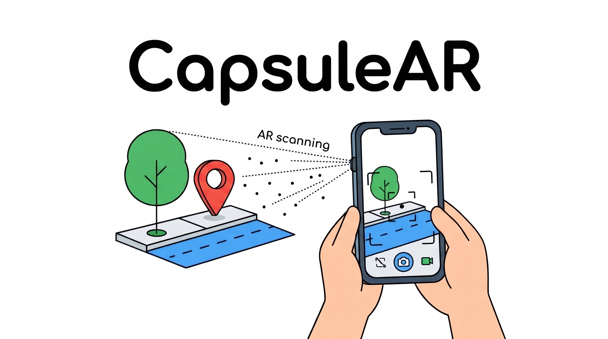
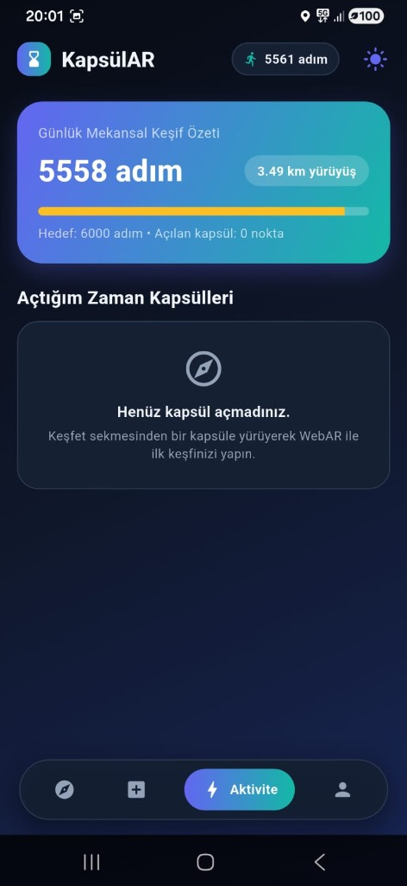
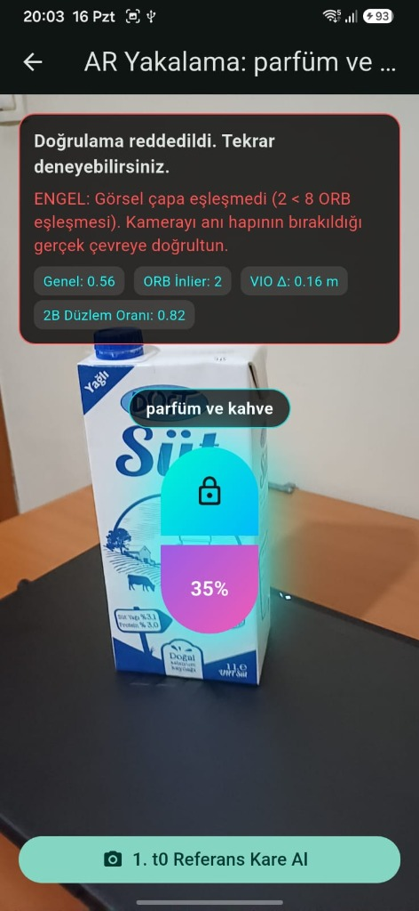

# KapsülAR — Küçük Şehir/İlçe ve Üniversite Odaklı Sosyal Yürüyüş Rotaları ve WebAR Zaman Kapsülü Sistemi

Küçük şehir/ilçelerde yaşayan halk ile üniversite öğrencilerinin hareketsizlik, sosyalleşememe ve *"çevrede gezilecek/yürünecek yer yok"* algısından kaynaklanan umutsuzluk döngüsünü kırmak amacıyla; **hazır ham kültürel rotaları** (Likya Yolu, Frig Vadisi vb.), **sıfırdan oluşturulabilen ve topluluk tarafından puanlanabilen yürüyüş rotalarını**, **otomatik yerel rota üretimini** ve **WebAR tabanlı konum kilitli dijital zaman kapsüllerini** birleştiren **Flutter (PWA + Mobil)** ve **ASP.NET Core (.NET 10) Uzamsal REST API** tabanlı araştırma ve uygulama projesi.

---

## Proje Künyesi (TÜBİTAK 2209-A Formatı)

| Alan | Bilgi |
| :--- | :--- |
| **Proje Başlığı** | Küçük Şehir ve Üniversite Yerleşkelerinde Fiziksel Aktivite ile Sosyal Etkileşimi Artırmaya Yönelik Ham/Topluluk Yürüyüş Rotaları ve Hibrit Konum Doğrulamalı WebAR Zaman Kapsülü Sisteminin Geliştirilmesi |
| **Grup Adı** | SOY Tech |
| **Proje Yürütücüsü** | Yusuf Çırak *(Tek Yürütücü)* |
| **Araştırmacılar (Proje Ortakları)** | Semih Beyaztaş, Ozan Hasköy |
| **Akademik Danışman** | *[Üniversite / Bölüm Danışmanı Unvan Ad Soyad]* |
| **Öngörülen Proje Süresi** | 12 Ay |

---

## 1. Özet ve Anahtar Kelimeler

Özellikle büyükşehir dışındaki küçük şehir ve ilçelerde yaşayan gençler, üniversite öğrencileri ve yerel halk; düzenli sosyal etkinlik ve yapılandırılmış yürüyüş rotası eksikliği nedeniyle yüksek düzeyde fiziksel hareketsizlik ve sosyal izolasyon riski yaşamaktadır. Mevcut harita ve adım sayar uygulamaları yalnızca mesafe ölçmekte; kullanıcıya çevresindeki keşfedilmemiş noktaları sosyal bir yürüyüş deneyimine dönüştüren, topluluk tarafından üretilip puanlanabilen ve konum sahteciliğine (GPS spoofing) karşı güvenli bir mekanizma sunmamaktadır.

Bu projede; (1) **Likya Yolu** ve **Frig Vadisi** gibi bilinen parkurların **ham GPS duraklı rotalarını** ve küçük ilçelerdeki kampüs/park hatlarını sunan, (2) kullanıcıların harita üzerinde dokunarak **0'dan yürüyüş rotası** oluşturabildiği veya OpenStreetMap/Wikipedia açık verileriyle bulunduğu noktadan otomatik çevre rotası üretebildiği, (3) rotaların diğer kullanıcılar tarafından **1–5 yıldız** ve **yürüyüş sonrası moral/sosyalleşme puanı** ile değerlendirilebildiği, (4) duraklara **AES-256-GCM** konumsal mühürlü ve **4 katmanlı anti-spoofing** korumalı **WebAR zaman kapsüllerinin** yerleştirilebildiği bir sistem tasarlanmakta ve saha deneyleriyle değerlendirilmektedir.

**Anahtar Kelimeler:** *Konum Tabanlı Artırılmış Gerçeklik (WebAR), Sosyal Yürüyüş Rotaları, Fiziksel Aktivite ve İyi Oluş, Uzamsal İndeksleme (PostGIS GiST/SP-GiST), GPS Anti-Spoofing, Kalman Filtresi.*

---

## 2. Amaç, Problem Tanımı ve Özgün Değer

### 2.1. Toplumsal ve Bilimsel Problem
- **Hareketsizlik ve Sosyal İzolasyon:** Küçük ilçe ve taşra üniversite yerleşkelerinde öğrenciler ile yerel halkın sosyalleşebileceği, yürüyüşe teşvik edecek yönlendirilmiş açık alan deneyimleri sınırlıdır. *"Burada gidilecek yer yok"* algısı ekran süresini artırmakta, fiziksel hareketliliği ve psikolojik iyi oluşu düşürmektedir.
- **Mevcut Uygulamaların Eksikleri:** Geleneksel fitness/adım sayar uygulamaları mekânsal anlam ve topluluk etkileşimi üretmez; mevcut oyunlaştırılmış konum uygulamaları ise *Mock GPS* yazılımlarıyla kolayca manipüle edilebilmekte ve kırsal/küçük ilçelerde içerik üretimi sunmamaktadır.
- **Uzamsal Sorgu Performansı:** Çok sayıda konum kapsülü ve rota durağı büyüdükçe 5–15 m yakınlık sorgularının mobil/PWA istemcilerde düşük gecikmeyle (`< 50 ms`) yanıtlanması gerekmektedir.

### 2.2. Özgün Değer ve Katkı
1. **Çift Katmanlı Rota Mimarisi (Ham Rotalar + 0'dan Topluluk Rotaları + Otomatik İlçe Rotası):** Sistem hem Likya Yolu ve Frig Vadisi gibi bilinen **ham rotaları** hem de kullanıcıların haritaya dokunarak **0'dan oluşturduğu** ve diğer kişilerin **yıldız/yorum/moral puanı** verebildiği rotaları destekler. Veri seyrek küçük ilçelerde bile `GET /api/routes/suggest` üzerinden otomatik yürüyüş döngüsü üretilir.
2. **4 Katmanlı Hibrit Anti-Spoofing + Konuma Bağlı Kriptografik Mühür:** Sunucu tarafı 30 saniyelik telemetri penceresinde; (i) işletim sistemi Mock Location & sinyal sapması analizi, (ii) yaya kinematiği (`8.5 m/s` ve `18.0 m/s` sıçrama sınırları), (iii) 2B Kalman konum yumuşatması ve (iv) ivmeölçer/jiroskop IMU füzyonu uygulayarak sahte GPS saldırılarını engeller; kapsül içeriğini ise `Geohash` + görsel imza tabanlı **AES-256-GCM** ile mühürler.
3. **Bütünleşik Sosyal Etki ve İyi Oluş Ölçümü:** Uygulama yalnızca adım sayısını değil, her yürüyüş ve rota değerlendirmesi sonrası kullanıcının **sosyalleşme isteği ve moral/iyi oluş puanını (1–5)** da ölçerek hareketsiz ve umutsuz yaşamın azaltılmasına yönelik deneysel veri toplar.

---

## 3. Araştırma Soruları ve Sayısal Hipotezler

- **AS1 (Uzamsal Performans):** PostGIS tabanlı uzamsal indeksleme stratejileri (`Geohash`, `SP-GiST`, `GiST`) 10.000 konum noktasında 5 m yarıçaplı yakınlık sorgularında gecikmeyi ve taranan aday sayısını nasıl etkiler?
  - **H1:** `GiST` ve `Geohash` ön filtreleme yaklaşımları, indekssiz sıralı taramaya kıyasla taranan aday nokta sayısını **≥ %90** azaltacak ve `k6` altında 200 eşzamanlı sanal kullanıcı yükünde **P95 < 50 ms** yanıt süresi sağlayacaktır.
- **AS2 (Konum Güvenliği):** 4 katmanlı kinematik + 2B Kalman + IMU sensör füzyonu mimarisi sahte GPS saldırılarını ne ölçüde tespit edebilir?
  - **H2:** Önerilen 4 katmanlı anti-spoofing motoru, sentetik ve gerçek Mock GPS/teleportasyon saldırılarında **≥ %95** engelleme doğruluğu ve normal yürüyüşlerde **≤ %5** yanlış pozitif oranı elde edecektir.
- **AS3 (Fiziksel Aktivite, Sosyalleşme ve İyi Oluş):** Sosyal yürüyüş rotaları, topluluk puanlaması ve WebAR kapsülleri küçük ilçe/kampüs kullanıcılarının hareketliliğini ve moral düzeyini anlamlı biçimde artırır mı?
  - **H3:** 4 haftalık saha çalışmasında deney grubunun (KapsülAR) haftalık ortalama adım sayısı ve rota tamamlama sıklığı, standart harita/adım sayar kullanan kontrol grubuna göre **≥ %25** daha yüksek olacak; yürüyüş sonrası iyi oluş/sosyalleşme skorunda istatistiksel olarak anlamlı (**p < 0.05**) artış gözlenecektir.
- **AS4 (Kullanılabilirlik):** Geliştirilen Flutter PWA/mobil arayüzü hedef kitle tarafından kullanılabilir ve benimsenebilir bulunur mu?
  - **H4:** Katılımcıların Sistem Kullanılabilirlik Ölçeği (SUS) ortalama puanı **≥ 75 / 100** (Bangor vd., 2008 "İyi/Mükemmel" eşiği) ve Teknoloji Kabul Modeli (TAM) algılanan fayda/kullanım kolaylığı ortalamaları **≥ 4.0 / 5.0** olacaktır.

---

## 4. Bilimsel Yöntem, Deney Tasarımı ve İstatistiksel Analiz Planı

Araştırma, mevcut çalışan prototipin (**ön çalışma / fizibilite doğrulaması**) üzerine inşa edilen 3 aşamalı deneysel bir yöntem izler:

### 4.1. Aşama 1 — Uzamsal Sorgu ve Yük Testi Deneyleri
- **Veri ve Ortam:** `backend/database/schema_postgis.sql` ve `SpatialIndexEngine.cs` üzerinde `N = 10.000` sentetik konum noktası, `r = 5.0 m` kilit yarıçapı ve `100` tekrarlı sorgu çalıştırılır.
- **Karşılaştırılan Yöntemler:** (M0) İndekssiz Sıralı Tarama, (M1) 7-karakter Geohash + 8 komşu B-Tree ön filtresi, (M2) `SP-GiST` (QuadTree bölümleme), (M3) `GiST` (R-Tree/MBR budama).
- **Yük Testi:** `backend/database/benchmark_k6.js` ile 15 sn 50 VU → 30 sn 200 VU → 15 sn 0 VU kademeli yük profili altında `P95 < 50 ms` eşiği ölçülür.

### 4.2. Aşama 2 — Anti-Spoofing ve Kriptografik Doğrulama Deneyleri
- **Senaryo Seti:** 30 saniyelik pencere üzerinde (a) normal yaya yürüyüşü (~1.4–1.8 m/s), (b) masa üstü sabit cihaz + sahte GPS enjeksiyonu (IMU durağan, GPS hareketli), (c) ani konum sıçraması (> 18 m/s) ve (d) Android Mock Provider bayraklı örnekler (`N ≥ 120` senaryo oturumu) test edilir; karmaşıklık matrisi (Precision, Recall, F1, FPR) çıkarılır.

### 4.3. Aşama 3 — Yarı-Deneysel Saha Çalışması (Küçük İlçe & Üniversite Öğrencileri)
- **Örneklem:** Gönüllülük esasına göre seçilen `n = 40` katılımcı (18–29 yaş üniversite öğrencileri ve küçük ilçe sakinleri) rastgele iki eşdeğer gruba ayrılır:
  - **Deney Grubu (n = 20):** KapsülAR uygulaması (Ham rotalar + 0'dan rota çizimi + rota puanlama + WebAR zaman kapsülü + iyi oluş geri bildirimi).
  - **Kontrol Grubu (n = 20):** Yalnızca standart dijital harita/adım sayar takibi (sosyal rota, puanlama ve WebAR kapsülü olmadan).
- **Ölçüm Araçları:** Uygulama içi `ResearchLabScreen` ve `DiscoveriesScreen` modülleri üzerinden günlük adım sayısı, yürünen km, tamamlanan rota sayısı, 10 maddelik **SUS** anketi, **TAM** maddeleri ve yürüyüş sonrası **1–5 İyi Oluş / Sosyalleşme İsteği** puanları toplanır.

### 4.4. İstatistiksel Analiz Planı
- Dağılım normalliği **Shapiro–Wilk** testi ile denetlenir.
- **Deney vs. Kontrol Grubu Karşılaştırması:** Normal dağılım durumunda **Bağımsız Örneklem t-Testi**, aksi durumda **Mann–Whitney U** testi; grup içi ön-test/son-test değişimi için **Eşli t-Testi / Wilcoxon İşaretli Sıralar Testi** uygulanır. Etki büyüklüğü **Cohen's *d*** (veya *r*) ile raporlanır.
- **Çoklu Uzamsal İndeks Kıyaslaması (M0–M3):** Tekrarlı sorgu süreleri **Friedman Testi** ve ardından **Holm–Bonferroni** düzeltmeli ikili karşılaştırmalarla analiz edilir (`α = 0.05`).

---

## 5. Proje Yönetimi (TÜBİTAK 2209-A Prosedürleri)

### 5.1. Ekip Görev Dağılımı
| Rol | Üye | Sorumluluk Alanları |
| :--- | :--- | :--- |
| **Proje Yürütücüsü** | **Yusuf Çırak** | Sistem mimarisi koordinasyonu, ASP.NET Core & PostGIS uzamsal servisler, anti-spoofing/kripto çekirdeği, istatistiksel analiz ve TÜBİTAK raporlama |
| **Araştırmacı (Proje Ortağı)** | **Semih Beyaztaş** | Flutter mobil/PWA arayüzü, OpenStreetMap rota çizim & harita katmanları, SUS/TAM & iyi oluş saha veri toplama |
| **Araştırmacı (Proje Ortağı)** | **Ozan Hasköy** | Ham rota (Likya, Frig, ilçe hatları) veri derleme, WebAR kamera/görsel çapa testleri, `k6` yük testi ve saha pilot organizasyonu |
| **Akademik Danışman** | *[Unvan Ad Soyad]* | Bilimsel yöntem denetimi, etik kurul başvuru rehberliği, akademik yayın/bildiri danışmanlığı |

### 5.2. İş Paketleri (İP), İş-Zaman Çizelgesi (12 Ay) ve Başarı Ölçütleri

| İş Paketi | Açıklama | Dönem (Ay) | Sorumlu | Başarı Ölçütü |
| :--- | :--- | :---: | :--- | :--- |
| **İP1: Literatür, Etik & Ham Rota Derleme** | Literatür taraması, Etik Kurul başvurusu, Likya/Frig/ilçe ham GPS rotalarının doğrulanması | 1 – 2 | Yusuf Çırak, Ozan Hasköy | Etik Kurul onayı; ≥ 4 doğrulanmış ham rota ve ≥ 15 kaynaklı tarama (%100) |
| **İP2: Uzamsal Altyapı & Anti-Spoofing Optimizasyonu** | PostgreSQL+PostGIS (`GiST`, `SP-GiST`, `Geohash`) kurulumu, 4 katmanlı anti-spoofing + AES-256-GCM testleri | 3 – 4 | Yusuf Çırak | `10.000` noktada benchmark ve `k6` `P95 < 50 ms`; spoof engelleme `≥ %95` |
| **İP3: İstemci Revizyonu (Rota Oluşturma, Puanlama & İyi Oluş)** | 0'dan rota çizici, otomatik çevre rota önerici, yıldız/yorum/moral puanlama ve WebAR akışı | 5 – 7 | Semih Beyaztaş | Tüm Android/Web/PWA cihazlarda hatasız çalışma; birim testleri %100 geçer |
| **İP4: Yarı-Deneysel Saha Çalışması (n = 40)** | Küçük ilçe/üniversite katılımcılarıyla 4 haftalık Kontrol vs. Deney grubu yürüyüş deneyi | 8 – 10 | Semih Beyaztaş, Ozan Hasköy | `n ≥ 40` katılımcıdan tam veri toplanması (`≥ %90` devam oranı) |
| **İP5: İstatistiksel Analiz ve Değerlendirme** | Adım, rota tamamlama, iyi oluş, SUS (`≥ 75`), TAM ve anti-spoofing metriklerinin analizi | 10 – 11 | Yusuf Çırak | Tüm hipotezlerin (H1–H4) `p < 0.05` düzeyinde test edilip raporlanması |
| **İP6: Sonuç Raporu, Bildiri ve Açık Kaynak Yayın** | TÜBİTAK sonuç raporu, ulusal/uluslararası bildiri taslağı, GitHub açık kaynak sürümü | 11 – 12 | Tüm Ekip | TÜBİTAK final raporunun teslimi ve 1 akademik bildiri başvurusu (%100) |

### 5.3. Risk Yönetimi ve B Planları

| Olası Risk | Etki | Olasılık | Önlem ve B Planı |
| :--- | :---: | :---: | :--- |
| **Saha çalışmasında katılımcı kaybı (n < 40)** | Yüksek | Orta | Başlangıçta %20 yedek (`48` kişi) kaydı alınır; üniversite yürüyüş/gezi kulüpleriyle eşgüdüm sağlanır. |
| **Kırsal/ilçe alanlarında mobil internet veya Overpass API kesintisi** | Orta | Orta | İstemcide `SharedPreferences` yerel önbelleği, hazır ham rotalar ve çevrimdışı döngü rota üretici devreye girer (B planı kodda mevcuttur). |
| **Kapalı alan veya düşük ışıkta WebAR görsel eşleşme düşüşü** | Orta | Düşük | 2B düzlem/ORB doğrulaması yetersiz kaldığında 30 sn Kalman + IMU penceresi ve pusula yönü sektör doğrulaması yedek katman olarak kullanılır. |
| **Dış mekan GPS çoklu yansıma (multipath) sapması** | Orta | Orta | 2B Kalman drift filtresi ve `5–15 m` yapılandırılabilir kilit yarıçapı ile hatalı reddetmeler önlenir. |

### 5.4. Bütçe Planlaması (TÜBİTAK 2209-A Üst Sınırı: 12.000 TL)

| Kalem | Birim / Adet | Tutar (TL) | Teknik ve Bilimsel Gerekçe |
| :--- | :---: | :---: | :--- |
| **Bulut Test Sunucusu (VPS + PostgreSQL/PostGIS + SSL/Alan Adı, 12 Ay)** | 1 Paket | 4.800 TL | Saha çalışmasında (n=40) gerçek PostGIS uzamsal sorgularının, telemetri kayıtlarının ve k6 yük testlerinin kesintisiz yürütülmesi için |
| **Saha Testi QR / Referans Tabela ve Basılı Bilgilendirme Materyali** | 40 Set | 1.900 TL | Pilot ilçe ve kampüs rota duraklarında görsel çapa testleri, katılımcı onam formları ve yönlendirme etiketleri için |
| **Taşınabilir Güç Kaynağı (Powerbank) ve Saha Test Telefon Tutucu** | 3 Adet | 2.700 TL | 4 haftalık açık alan GPS/IMU/WebAR ölçümlerinde cihaz pil kesintisini önlemek ve sabit kamera açısıyla ölçüm almak için |
| **Akademik Bildiri Katılım / Kırtasiye ve Sarf Giderleri** | 1 Kalem | 2.000 TL | İP6 kapsamında elde edilen deney sonuçlarının ulusal öğrenci/mühendislik kongresinde sunulması ve basılı anket yedekleri için |
| **GENEL TOPLAM** | — | **11.400 TL** | *TÜBİTAK 2209-A 12.000 TL üst sınırı ile uyumludur.* |

### 5.5. Etik Kurul, KVKK ve Üretken Yapay Zekâ (ÜYZ) Beyanı
- **Etik Kurul ve Gönüllü Onam:** Saha çalışması öncesinde üniversitenin Sosyal/Beşeri Bilimler veya Mühendislik Etik Kurulu'ndan izin alınır; tüm katılımcılardan aydınlatılmış onam formu toplanır.
- **KVKK ve Veri Gizliliği:** Konum telemetrisi yalnızca son 30 saniyelik doğrulama penceresinde işlenir; kalıcı veritabanında ham kişisel kimlik yerine anonimleştirilmiş `userId` (`demo-user` / kodlanmış ID) tutulur. Açık lisanslı görseller için yalnızca Wikimedia Commons / Wikipedia / OpenStreetMap verileri kullanılarak telif ihlali önlenir.
- **ÜYZ Kullanım Beyanı:** Projenin mimari tasarımında, kod incelemesinde ve belge düzenlemesinde üretken yapay zekâ araçlarından yardımcı araç olarak yararlanılmış; tüm algoritmalar, deneysel eşikler, kaynakça DOI doğrulamaları ve saha planlaması proje ekibi tarafından kontrol edilip doğrulanmıştır.

---

## 6. Yaygın Etki

- **Toplumsal Etki:** Küçük ilçe ve taşra üniversitelerindeki hareketsiz gençlerin ve halkın, "gezilecek yer yok" önyargısını kırarak sıfırdan yürüyüş rotaları oluşturması, birbirlerinin rotalarını puanlaması ve güvenli açık alan sosyalleşmesine katılması hedeflenmektedir.
- **Akademik ve Teknolojik Çıktı:** Elde edilecek uzamsal indeksleme kıyaslama verileri (`GiST` vs `SP-GiST` vs `Geohash`), 4 katmanlı anti-spoofing başarı metrikleri ve saha aktivite/iyi oluş bulguları en az 1 ulusal/uluslararası konferans bildirisine dönüştürülecektir.
- **Açık Kaynak ve Sürdürülebilirlik:** Projenin kaynak kodu, PostGIS şeması, `k6` benchmark betikleri ve anonimleştirilmiş rota/performans veri seti GitHub üzerinden açık kaynak olarak paylaşılacaktır.

---

## 7. Mimari Bileşenler ve Uygulama Özellikleri

| Katman | Teknoloji | Konum |
|---|---|---|
| **İstemci (PWA & Mobil)** | Flutter (Material 3, `flutter_map`, `geolocator`, `sensors_plus`, WebRTC `getUserMedia`) | `flutter_app/` |
| **Sunucu & Uzamsal API** | ASP.NET Core (.NET 10) Minimal API | `backend/` |
| **Veritabanı Şeması & Yük Testi** | PostgreSQL + PostGIS (`GiST`, `SP-GiST`, `Geohash`) & `k6` | `backend/database/` |
| **Görsel & Mekânsal Açık Veri** | Wikimedia Commons, Wikipedia Geosearch & OpenStreetMap Overpass API | `WikimediaMediaService.cs` |

### 7.1. Sade ve Anlaşılır 4 Sekmeli Arayüz (WIP User Interface)

- **Keşfet (Harita + Yürüyüş Rotaları + Kapsüller):**
  - OpenStreetMap haritası üzerinde 15 m WebAR tetikleme / 5 m kilit halkaları, pusula yönelim göstergesi, Wikimedia görselli kapsül kartları ve **Yürüyüş Simülatörü (1.5 m/s)**.
  - **Ham Rotalar & Topluluk Rotaları:** Likya Yolu, Frig Vadisi, Oltu İlçe Öğrenci Hattı ve Beyazıt rotaları haritada `Polyline` + numaralı duraklarla çizilir; **`Rota Öner`** ile bulunulan konumdan otomatik rota üretilir, **`0'dan Çiz`** ile yeni rota başlatılır.
  - **Rota Detayı ve Puanlama:** Her rota için `1–5 yıldız` puan, yorum, `1–5` yürüyüş sonrası moral/sosyalleşme puanı ve `Rotayı Tamamla` akışı sunulur.

| Keşfet (Açık Tema) | Keşfet (Karanlık Tema) |
| :---: | :---: |
|  |  |

- **Bırak / Oluştur (Zaman Kapsülü & 0'dan Rota Oluşturucu):**
  - **Zaman Kapsülü:** Bulunulan GPS koordinatına Metin/Şifreli Not, Fotoğraf, **16×16 Piksel Sanat Tuvali**, Sesli Anı oluşturma ve Wikimedia Commons görseli ekleme.
  - **0'dan Rota Oluştur:** Haritaya dokunarak veya yakındaki açık alanları ekleyerek durak durak rota çizme, zorluk ve sosyal buluşma etiketi belirleme.

| Zaman Kapsülü Bırak |
| :---: |
|  |

- **Aktivite & Profil (İyi Oluş Ölçümü & Araştırma Laboratuvarı):**
  - **Aktivite:** Günlük adım sayısı, yürünen mesafe (km), tamamlanan rota sayısı, açılan kapsüller ve **Yürüyüş Sonrası Moral & Sosyalleşme İsteği (1–5)** check-in modülü.
  - **Profil & Araçlar:** Karanlık Tema anahtarı, Gerçek GPS Modu, kilit yarıçapı (5 m / 10 m / 15 m) ve **Araştırma Laboratuvarı**:
    - **10.000 Noktalı Canlı Uzamsal İndeks Kıyaslaması:** İndekssiz tarama vs `Geohash` vs `SP-GiST (QuadTree)` vs `GiST (R-Tree/MBR)`.
    - **30 Saniyelik Hibrit Anti-Spoofing Testi:** Normal yürüyüş vs imkansız GPS sıçraması + sensör füzyonu tutarlılığı.
    - **SUS & TAM Değerlendirme Formu:** Anlık SUS puanı hesaplama (hedef ≥ 75).

| Aktivite Sekmesi | Profil & Araştırma Laboratuvarı |
| :---: | :---: |
|  |  |

### 7.2. WebAR / AR Anti-Spoof Kilit Açma Akışı (Anı Hapı)

- Kapsüle 15 m yaklaşıldığında harita radarı üzerinden WebRTC kamera (`navigator.mediaDevices.getUserMedia`), IMU ve görsel çapa doğrulaması tetiklenir.
- **ORB inlier eşleşmesi**, **VIO yer değiştirme (`VIO Δ`)** ve **2B düzlem oranı (anti-spoofing)** kontrolleri geçildiğinde; sunucu tarafı son 30 saniyelik 4 katmanlı doğrulama penceresini onaylar ve AES-256-GCM mühürlü kapsülü çözer.

| 1. Harita Radarı & Menzil | 2. Görsel Çapa & Anti-Spoof Reddi | 3. Doğrulama & Şifre Çözme |
| :---: | :---: | :---: |
|  |  |  |

---

## 8. Çalıştırma Talimatları

### A. Backend API (.NET 10)
```powershell
cd backend
dotnet run
```
Sunucu varsayılan olarak `http://localhost:5088` adresinde çalışır.

### B. Flutter Uygulaması (PWA / Web veya Mobil)
```powershell
cd flutter_app
flutter pub get
flutter run -d chrome
```
> **Not:** Android emülatöründe `ApiClient` otomatik olarak `http://10.0.2.2:5088` adresini kullanır; gerekirse **Lab** sekmesinden API adresi değiştirilebilir.

### C. PostgreSQL + PostGIS ve k6 Yük Testi (Opsiyonel Üretim Ortamı)
- Şema ve indeksler: `backend/database/schema_postgis.sql`
- Yük testi: `k6 run backend/database/benchmark_k6.js`

---

## 9. Kaynakça

1. Althoff, T., White, R. W., & Horvitz, E. (2016). Influence of Pokémon Go on Physical Activity: Study and Implications. *Journal of Medical Internet Research*, 18(12), e315. DOI: `10.2196/jmir.6759`
2. Mazeas, A., Duclos, M., Pereira, B., & Chalabaev, A. (2022). Evaluating the Effectiveness of Gamification on Physical Activity: Systematic Review and Meta-analysis of Randomized Controlled Trials. *Journal of Medical Internet Research*, 24(1), e26779. DOI: `10.2196/26779`
3. Tzima, S., Styliaras, G., Bassounas, A., & Tzima, M. (2023). Location-Based Augmented Reality for Cultural Heritage Education: Creating Educational, Gamified Location-Based AR Applications for the Prehistoric Lake Settlement of Dispilio. *Sensors*, 23(10), 4963. DOI: `10.3390/s23104963`
4. Guttman, A. (1984). R-trees: A dynamic index structure for spatial searching. *Proceedings of the 1984 ACM SIGMOD International Conference on Management of Data*, 47–57. DOI: `10.1145/971697.602266`
5. Rublee, E., Rabaud, V., Konolige, K., & Bradski, G. (2011). ORB: An efficient alternative to SIFT or SURF. *2011 International Conference on Computer Vision (ICCV)*, 2564–2571. DOI: `10.1109/ICCV.2011.6126544`
6. Scott, L., & Denning, D. E. (2003). A Location Based Encryption Technique and Some of Its Applications. *Proceedings of the Institute of Navigation (ION) National Technical Meeting*, 734–740.
7. Dworkin, M. (2007). *Recommendation for Block Cipher Modes of Operation: Galois/Counter Mode (GCM) and GMAC* (NIST Special Publication 800-38D). National Institute of Standards and Technology.
8. IEEE Sensors Journal (2024). Application of IMU/GPS Integrated Navigation System Based on Adaptive Unscented Kalman Filter Algorithm. *IEEE Sensors Journal*. DOI: `10.1109/JSEN.2024.3365979`
9. IEEE SIU (2023). Spoofing Detection and Anti-Spoofing Kalman Filter Design for an Accelerometer-Integrated GNSS Receiver. *2023 31st Signal Processing and Communications Applications Conference (SIU)*. DOI: `10.1109/SIU59756.2023.10223944`
10. Brooke, J. (1996). SUS: A "quick and dirty" usability scale. In P. W. Jordan, B. Thomas, B. A. Weerdmeester, & I. L. McClelland (Eds.), *Usability Evaluation in Industry* (pp. 189–194). Taylor & Francis. DOI: `10.1201/9781498710411-35`
11. Bangor, A., Kortum, P. T., & Miller, J. T. (2008). An Empirical Evaluation of the System Usability Scale. *International Journal of Human–Computer Interaction*, 24(6), 574–594. DOI: `10.1080/10447310802205776`
12. Davis, F. D. (1989). Perceived Usefulness, Perceived Ease of Use, and User Acceptance of Information Technology. *MIS Quarterly*, 13(3), 319–340. DOI: `10.2307/249008`
