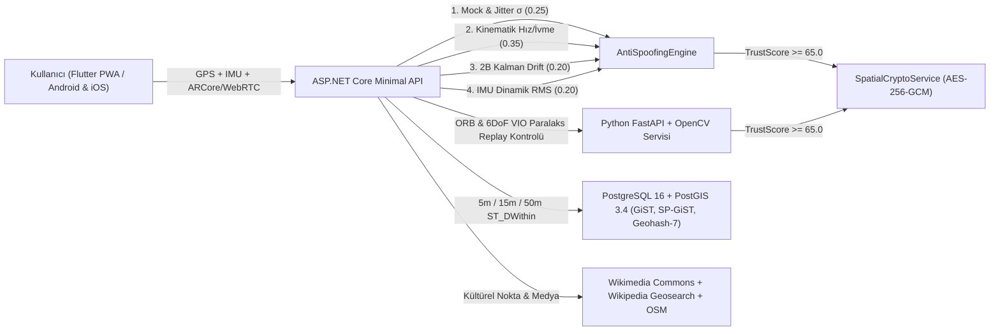

# KapsülAR — Konum Tabanlı Artırılmış Gerçeklik Sistemlerinde Çok Sensörlü Konum Sahteciliği Tespiti ve PostGIS Uzamsal İndeksleme Yapılarının Performans Analizi

[](backend/)
[](flutter_app/)
[](backend/database/schema_postgis.sql)
[](#-proje-k%C3%BCnyesi-t%C3%BCbi%CC%87tak-2209-a-format%C4%B1)

Konum tabanlı mobil ve web artırılmış gerçeklik (WebAR) uygulamalarındaki **sahte konum (GPS spoofing) enjeksiyonları** ile yüksek kullanıcı yoğunluğu altındaki **uzamsal veritabanı sorgu darboğazlarına** ölçülebilir ve deneysel olarak doğrulanabilir çözümler sunan açık kaynaklı araştırma platformudur[cite: 1]. Sistem; çok sensörlü anti-spoofing modeli, `AES-256-GCM` konum mühürlemesi ve PostGIS uzamsal indeksleme kıyaslama altyapısını kontrollü bir test yatağı olan **KapsülAR** üzerinde birleştirir[cite: 1].

---

## Proje Künyesi (TÜBİTAK 2209-A Formatı)

| Alan | Bilgi |
| :--- | :--- |
| **Proje Başlığı** | Konum Tabanlı Artırılmış Gerçeklik Sistemlerinde Çok Sensörlü Konum Sahteciliği Tespiti ve PostGIS Uzamsal İndeksleme Yapılarının Performans Analizi: KapsülAR[cite: 1] |
| **Araştırma Grubu** | **SOY Tech**[cite: 1] |
| **Proje Yürütücüsü** | **Semih Beyaztaş** [cite: 1] |
| **Araştırmacılar** | **Ozan Hasköy**, **Yusuf Çırak**[cite: 1] |
| **Proje Danışmanı** | *[Danışman Unvanı Adı Soyadı - Üniversite / Bölüm]*[cite: 1] |
| **Yürütüleceği Kurum** | *[Üniversite / Fakülte / Bölüm Adı]*[cite: 1] |
| **Öngörülen Proje Süresi** | 12 Ay[cite: 1] |
| **Talep Edilen Bütçe** | 8.000,00 TL [cite: 1] |

---

## 1. Özet ve Anahtar Kelimeler

Konum tabanlı mobil ve web artırılmış gerçeklik (WebAR) uygulamaları, istemci tarafından bildirilen GNSS koordinatlarına doğrudan güvenmeleri nedeniyle sahte konum (*GPS spoofing*) enjeksiyonlarına ve yüksek kullanıcı yoğunluğu altında uzamsal veritabanı sorgu darboğazlarına karşı savunmasızdır[cite: 1]. Bu proje, söz konusu iki temel mühendislik problemine ölçülebilir ve deneysel olarak doğrulanabilir çözümler üretmeyi amaçlamaktadır[cite: 1]. Önerilen mimari, test ortamı olarak konum-kilitli dijital zaman kapsülü uygulaması **KapsülAR** üzerinde değerlendirilmektedir[cite: 1].

Bilimsel nitelik açısından çalışma[cite: 1];
1. Android/iOS `Mock Location` bayrağı, sinyal doğruluk sapması, kinematik hız-ivme sınırları, yerel teğet düzlemde iki boyutlu Kalman filtresi, yerçekiminden arındırılmış IMU sensör füzyonu ve ORB/paralaks tabanlı görsel doğrulamayı birleştiren çok katmanlı bir anti-spoofing modeli geliştirmekte[cite: 1];
2. PostgreSQL/PostGIS üzerinde **İndekssiz**, **Geohash-7**, **SP-GiST (QuadTree)** ve **GiST (R-Tree/MBR)** yapılarının `5 m`, `15 m` ve `50 m` yakınlık sorgusu gecikmesini **10.000–50.000 noktalı** gerçek (Wikimedia/OSM) ve sentetik veri setleri üzerinde karşılaştırmaktadır[cite: 1].

Sistem **.NET 10 (ASP.NET Core Minimal API)**, **Flutter (PWA/Mobil)**, **Python FastAPI + OpenCV**, **AES-256-GCM** konum mühürlemesi ve **PostgreSQL 16 + PostGIS 3.4** bileşenleriyle kurgulanmış; `k6` yük testleri (`50–200` eşzamanlı kullanıcı) ile `p50`, `p95` ve `p99` gecikmeleri ölçülerek GiST/SP-GiST ile indekssiz sorgulara göre en az **%75** hız artışı hedeflenmiştir[cite: 1]. Ayrıca **240 etiketli oturumda** F1-skoru (**≥ %90**) ve ROC-AUC değerleri hesaplanmakta, **30 üniversite öğrencisiyle 2 haftalık** kampüs saha deneyi yürütülerek **SUS (> 75)** ve **TAM** ölçekleri uygulanmaktadır[cite: 1].

**Anahtar Kelimeler:** *Uzamsal Veritabanları, PostGIS, GPS Sahteciliği Tespiti, Sensör Füzyonu, Artırılmış Gerçeklik (WebAR).*[cite: 1]

---

## 2. Bilimsel Nitelik, Problem Tanımı ve Özgün Değer

### 2.1. Konunun Önemi ve Problemin Tanımı
- **Konum Sahteciliği (GPS/GNSS Spoofing) ve Kentsel Sinyal Kayması:** Salt istemcinin raporladığı enlem-boylam bilgisine güvenen mimariler; geliştirici seçenekleri üzerinden çalıştırılan sahte konum (*Mock Location*) uygulamaları, ani koordinat sıçramaları (*teleportation*), cihaz masa üstünde hareketsizken gönderilen sahte yürüyüş izleri ve kamerayı ekrana/fotoğrafa tutarak yapılan 2B görsel tekrar (*replay*) saldırılarıyla kolayca atlatılabilmektedir[cite: 1].
- **Yüksek Eşzamanlılıklı Uzamsal Sorgu Darboğazı:** On binlerce coğrafi nokta arasından dar yarıçaplı (`5 m`) *geofencing* sorgularının milisaniyeler içinde yanıtlanması, uygun uzamsal indeksleme mimarisi seçilmediğinde `O(N)` sıralı tarama maliyeti nedeniyle sunucu darboğazına yol açmaktadır[cite: 1].
- **Ulusal Strateji Uyumu:** Çalışma; **12. Kalkınma Planı** ve **2030 Sanayi ve Teknoloji Stratejisi** kapsamında öncelikli Ar-Ge alanları olan siber güvenlik/veri bütünlüğü, büyük ölçekli coğrafi bilgi sistemleri (CBS) altyapıları ve kültürel mirasın dijitalleştirilmesi hedefleriyle doğrudan örtüşmektedir[cite: 1].

### 2.2. Projenin Somut Hedefleri ve Özgün Katkıları
1. **Hibrit Çok Katmanlı Anti-Spoofing Motoru:** İstemci IMU/GNSS telemetrisi ile sunucu tarafı 2B Kalman filtresi ve ORB/6DoF VIO paralaks görsel doğrulamasını birleştirerek sahte konum ve 2B ekran replay saldırılarını **≥ %90 F1-skoru** ile engeller[cite: 1].
2. **Uzamsal İndeksleme Performans Profili:** `10.000`, `25.000` ve `50.000` nokta ölçeğinde `GiST (R-Tree)`, `SP-GiST (QuadTree)`, `Geohash-7` ve indekssiz yaklaşımların PostGIS ve `k6` (`50–200 VU`) altında karşılaştırmalı performans profilini çıkarır[cite: 1].
3. **Konuma Bağlı Kriptografik Mühürleme (Geo-Encryption):** `AES-256-GCM` ve `HMAC-SHA256` tabanlı anahtar türetimiyle kapsül içeriğini `Geohash-7 + 30° yönelim sektörü + görsel imzaya` bağlayarak fiziksel doğrulama geçilmeden verinin çözülememesini sağlar[cite: 1].
4. **Saha Kullanılabilirliği ve Açık Kaynak Benchmark:** 30 üniversite öğrencisiyle 2 haftalık kampüs saha testinde kullanılabilirliği doğrular ve 50.000 noktalı uzamsal benchmark ile 240 oturumluk anti-spoofing veri setini açık kaynak olarak yayımlar[cite: 1].

---

## 3. Araştırma Soruları ve Ölçülebilir Hipotezler

| No | Araştırma Sorusu | Ölçülebilir Hipotez |
| :--- | :--- | :--- |
| **AS1** | Çok sensörlü IMU füzyonu (ivmeölçer dinamik RMS ve jiroskop enerjisi), yerel teğet düzlem 2B Kalman filtresi ve AR görsel çapa/paralaks doğrulaması birleştirildiğinde, yazılım tabanlı konum sahteciliği ve 2B ekran tekrar saldırıları ne düzeyde ayırt edilebilir?[cite: 1] | **H1 (Anti-Spoofing):** Çok katmanlı sensör füzyonu + Kalman + AR görsel doğrulama modeli; Mock GPS, teleportation, hareketsiz IMU spoofing ve düzlemsel ekran replay saldırılarını salt GPS eşik kontrolüne kıyasla en az **%90 F1-skoru** ve **%92 doğrulukla** tespit edecek, yanlış pozitif oranını (**FPR**) **%5'in altında** tutacaktır[cite: 1]. |
| **AS2** | 10.000 ila 50.000 coğrafi nokta barındıran PostGIS ortamında farklı arama yarıçapları (`5 m`, `15 m`, `50 m`) ve eşzamanlı yükler altında İndekssiz tarama, Geohash-7 ön filtreleme, SP-GiST (QuadTree) ve GiST (R-Tree/MBR) indeksleri sorgu gecikmesi ve aday tarama maliyeti açısından nasıl farklılaşmaktadır?[cite: 1] | **H2 (Uzamsal Performans):** PostgreSQL + PostGIS üzerinde `GiST` ve `SP-GiST` uzamsal indeksleme yapıları, `10.000+` noktalı veri setinde `5 m` yakınlık sorgularında indekssiz (*Sequential Scan*) sorgulara göre ortalama sorgu gecikmesini en az **%75 düşürecek** ve `k6` altında **200 eşzamanlı sanal kullanıcıda (VU)** `p95` yanıt süresini **50 ms'nin altında** tutacaktır[cite: 1]. |
| **AS3** | Uygulanan çok katmanlı güvenlik doğrulaması, gerçek saha koşullarında son kullanıcı kullanılabilirliğini bozmadan yüksek kabul düzeyine ulaşabilir mi?[cite: 1] | **H3 (Kullanılabilirlik):** KapsülAR prototipi ile yürütülecek **30 katılımcılı** kampüs saha testinde ortalama Sistem Kullanılabilirlik Ölçeği (**SUS**) puanı **75'in üzerinde (`> 75`)** ve Teknoloji Kabul Modeli (**TAM**) algılanan kullanışlılık/kolaylık ortalaması 5 üzerinden **≥ 4,0** düzeyinde gerçekleşecektir[cite: 1]. |

---

## 4. Bilimsel Yöntem, Matematiksel Model ve İstatistiksel Plan

### 4.1. Sistem Mimarisi ve Doğrulama Akışı



### 4.2. Algoritmik ve Matematiksel Formülasyon

#### A. 2B Sabit-Hız Kalman Süzgeci ve İnovasyon Sapması
Kentsel/kampüs GPS çoklu yansıma (`15–25 m`) gürültüsünü süzmek ve ani sahte konum sıçramalarını ölçmek için yerel teğet düzlemde ($x$: doğu, $y$: kuzey metre cinsinden) durum kestirimi uygulanır[cite: 1]:

$$\hat{x}_{k|k-1} = x_{k-1} + v_{x,k-1}\Delta t, \qquad \hat{y}_{k|k-1} = y_{k-1} + v_{y,k-1}\Delta t$$

$$K_k = \frac{P_{k|k-1}}{P_{k|k-1} + R_k}, \qquad R_k = 0.45 \cdot \mathrm{clamp}(\sigma_{\text{GPS}}, 2.5, 35.0)^2$$

$$e_k = \sqrt{(m_{x,k} - \hat{x}_{k|k-1})^2 + (m_{y,k} - \hat{y}_{k|k-1})^2}$$

Burada $e_k$ (`KalmanInnovationMeters`) ani teleportasyon/sahte konum enjeksiyonlarında eşik değeri ($e_k > 25.0\text{ m}$) aşarak Katman 3 alarmı üretir.

#### B. 4 Katmanlı Hibrit Güven Skoru ($T_{\text{trust}}$)
Son $30\text{ sn}$ telemetri penceresi üzerinden hesaplanan bileşik güven skoru:

$$T_{\text{trust}} = 0.25\,L_1 + 0.35\,L_2 + 0.20\,L_3 + 0.20\,L_4$$

- **$L_1$ (Sağlayıcı & Sinyal Bütünlüğü):** `IsMocked` bayrağı, $0.0\text{ m}$ sahte doğruluk ve doğruluk standart sapması ($\sigma_{\text{acc}} < 0.001$) kontrolü[cite: 1].
- **$L_2$ (Kinematik Fizik):** Haversine mesafesinden türetilen hız ($v_{\max} \le 8.5\text{ m/s}$ yaya sınırı, $v > 18.0\text{ m/s}$ veya $2\text{ sn}$'de $> 32\text{ m}$ imkansız sıçrama) ve ivme ($a_{\max} \le 12.0\text{ m/s}^2$)[cite: 1].
- **$L_3$ (Kalman Drift Filtresi):** İnovasyon sapması $e_k \le 12.0\text{ m}$ için tam puan, $e_k > 25.0\text{ m}$ için ret.
- **$L_4$ (IMU Sensör Füzyonu & Görsel Paralaks):** Yerçekimi ortalamasından arındırılmış ivmeölçer dinamik RMS enerjisi ($\text{RMS}_{\text{dyn}} < 0.045\text{ m/s}^2$ iken $> 10\text{ m}$ GPS hareketi varsa sabit-cihaz sahteciliği tespiti) ve ORB / 6DoF VIO paralaks düzlem oranı ile 2B ekran replay koruması[cite: 1].

#### C. Konuma Bağlı Anahtar Türetimi (`AES-256-GCM`)
$$K_{\text{spatial}} = \mathrm{HMAC\text{-}SHA256}\big(K_{\text{master}}, \; \text{capsuleId} \parallel \mathrm{Geohash}_7(\phi,\lambda) \parallel \text{sector}_{30^\circ} \parallel \text{visualSig}\big)$$

Şifreleme 12 baytlık rastgele `nonce`, 16 baytlık bütünlük etiketi (`tag`) ve `AAD` ile doğrulanır.

#### D. SUS Puanlaması
10 maddelik Sistem Kullanılabilirlik Ölçeği puanı (Brooke, 1996):

$$\text{SUS} = 2.5 \times \left( \sum_{i \in \{1,3,5,7,9\}} (a_i - 1) + \sum_{i \in \{2,4,6,8,10\}} (5 - a_i) \right)$$

### 4.3. Deneysel Tasarım ve İstatistiksel Analiz Planı

1. **Deney 1 — Uzamsal İndeksleme ve Yük Performansı (`H2`):** Wikimedia/Wikipedia Geosearch ve OpenStreetMap'ten çekilen gerçek kültürel noktalar ile sentetik dağılımlardan oluşan **10.000, 25.000 ve 50.000 noktalı** veri setleri üzerinde; **İndekssiz (Sequential Scan)**, **Geohash-7 (+8 komşu ön filtreleme)**, **SP-GiST (QuadTree)** ve **GiST (R-Tree/MBR)** yapıları `5 m`, `15 m`, `50 m` yarıçaplarda ve `k6` (`50 → 200 VU`) yükü altında karşılaştırılır[cite: 1]. Ortalama, `p50`, `p95`, `p99` gecikme (ms), taranan aday nokta sayısı, `RPS` ve indeks bellek kullanımı (`KB`) kaydedilir[cite: 1].
2. **Deney 2 — Çok Katmanlı Konum Sahteciliği Tespiti (`H1`):** Toplam **240 etiketli oturum** üzerinde değerlendirme yapılır[cite: 1]:
   - **120 Meşru Oturum:** Gerçek fiziksel yürüyüş ve dönüş oturumları (`1,2–1,8 m/s` yürüyüş ve hafif koşu)[cite: 1].
   - **120 Kontrollü Saldırı Oturumu:** `30` Mock Location enjeksiyonu, `30` ani koordinat sıçraması (`> 18 m/s`), `30` masa üstünde sabit cihazla sentetik GPS rotası (`IMU RMS < 0,045 m/s²`) ve `30` monitör/fotoğraf üzerinden 2B düzlemsel ekran tekrar (*replay*) saldırısı[cite: 1].
   - Metrikler: Accuracy, Precision, Recall, F1-Skoru, FPR, FNR ve ROC-AUC[cite: 1].
3. **Deney 3 — Kampüs İçi Saha ve Kullanılabilirlik Testi (`H3`):** Üniversite kampüsü ve yakın çevresinde belirlenen **20 fiziksel kapsül noktasında**, gönüllü onam veren sabit **N = 30 üniversite öğrencisi** (olası ayrılmalara karşı `38` davet) **2 hafta** boyunca sistemi açık alanda kullanır[cite: 1]. Çalışma sonunda **10 maddelik SUS** (`hedef > 75`) ve **TAM** (Algılanan Kullanışlılık: 4 madde, Algılanan Kullanım Kolaylığı: 4 madde, Davranışsal Niyet: 2 madde) ölçekleri uygulanır[cite: 1].
4. **İstatistiksel Yöntemler:** Normallik için **Shapiro–Wilk**; dört indeks stratejisinin kıyaslanmasında tekrarlı ölçümler için **Friedman Testi** ve ikili karşılaştırmalarda **Holm–Bonferroni düzeltmeli Wilcoxon İşaretli Sıralar Testi**; Deney 2'de salt GPS temel yöntemi ile hibrit modelin karşılaştırmasında **McNemar Testi**; Deney 3'te ölçek iç tutarlılığı için **Cronbach Alfa ($\alpha \ge 0,70$)** ve SUS ortalamasının `75` eşiğinden yüksekliği için **Tek Örneklem t-Testi / Wilcoxon Testi** ($p < 0,05$) kullanılır[cite: 1].

---

## 5. Proje Yönetimi (TÜBİTAK 2209-A Prosedürleri)

### 5.1. Ekip Görev Dağılımı
| Rol | Üye | Sorumlu Olduğu İş Paketleri ve Görevler |
| :--- | :--- | :--- |
| **Proje Yürütücüsü** | **Semih Beyaztaş**[cite: 1] | **İP2, İP3, İP6:** Sistem mimarisi koordinasyonu, 4 katmanlı Kalman/IMU anti-spoofing ve ORB/VIO paralaks algoritmalarının geliştirilmesi, McNemar/ROC-AUC istatistiksel analizleri[cite: 1]. |
| **Araştırmacı** | **Ozan Hasköy**[cite: 1] | **İP1, İP4, İP6:** PostgreSQL + PostGIS (`GiST`, `SP-GiST`, `Geohash`) veritabanı tasarımı, `10.000–50.000` noktalı veri seti üretimi, `k6` yük testleri ve Friedman/Wilcoxon gecikme analizleri[cite: 1]. |
| **Araştırmacı** | **Yusuf Çırak**[cite: 1] | **İP1, İP3, İP5:** Flutter (PWA + Mobil) istemci ve WebAR/AR arayüz geliştirme, Wikimedia API entegrasyonu, `30` katılımcılı kampüs saha deneyinin yürütülmesi ve SUS/TAM veri toplama[cite: 1]. |
| **Proje Danışmanı** | *[Unvan Ad Soyad]*[cite: 1] | Bilimsel yöntem denetimi, Etik Kurul başvuru rehberliği ve akademik bildiri yayını. |

### 5.2. Çalışma Takvimi (İş Paketleri — 12 Ay)

| İP No | Faaliyetlerin Tanımı | Zaman Aralığı | Başarı Ölçütü | Katkı (%) |
| :---: | :--- | :---: | :--- | :---: |
| **İP1**[cite: 1] | Wikimedia/OSM gerçek konumlarının ve `10.000–50.000` noktalı sentetik uzamsal veri setlerinin üretilmesi; PostgreSQL + PostGIS (`GiST`, `SP-GiST`, `Geohash-7`) şemasının kurulumu[cite: 1] | 1–2. Aylar[cite: 1] | `50.000` noktalı veri setinin ve 3 indeksli PostGIS şemasının %100 hatasız yüklenmesi[cite: 1] | 15[cite: 1] |
| **İP2**[cite: 1] | 4 katmanlı sensör füzyonu (Mock, jitter, kinematik hız/ivme, 2B Kalman, IMU RMS) anti-spoofing motorunun kalibrasyonu ve `120` saldırı senaryosu simülatörünün kodlanması[cite: 1] | 2–4. Aylar[cite: 1] | Kalibrasyon veri setinde `≥ %90` tespit duyarlılığı ve `< %5` yanlış pozitif oranı[cite: 1] | 20[cite: 1] |
| **İP3**[cite: 1] | WebAR / ARCore ORB görsel çapa eşleştirme, 6DoF VIO paralaks canlılık kontrolü ve `AES-256-GCM` konum mührünün istemci-sunucu entegrasyonu[cite: 1] | 4–6. Aylar[cite: 1] | 2B ekran replay saldırı testlerinde `≥ %90` engelleme ve uçtan uca şifre çözme[cite: 1] | 20[cite: 1] |
| **İP4**[cite: 1] | 4 uzamsal indeksleme stratejisinin `5/15/50 m` yarıçaplarda ve `k6` (`50–200 VU`) yükü altında karşılaştırmalı gecikme/RPS deneylerinin yürütülmesi[cite: 1] | 6–8. Aylar[cite: 1] | GiST/SP-GiST ile `≥ %75` gecikme azalması ve `200 VU`'da `p95 < 50 ms` doğrulaması[cite: 1] | 15[cite: 1] |
| **İP5**[cite: 1] | 20 kampüs kapsül noktasında `N = 30` gönüllü öğrenci ile 2 haftalık saha deneyi, red-team spoofing denemeleri ve SUS/TAM anket verilerinin toplanması[cite: 1] | 8–10. Aylar[cite: 1] | 30 katılımcıdan eksiksiz saha logu ve `≥ 30` geçerli SUS/TAM anket formu toplanması[cite: 1] | 15[cite: 1] |
| **İP6**[cite: 1] | Shapiro–Wilk, Friedman/Wilcoxon, McNemar ve Cronbach $\alpha$ istatistiksel analizlerinin tamamlanması; açık kaynak benchmark deposu ve doğrulama paketinin yayımlanması[cite: 1] | 10–12. Aylar[cite: 1] | Tüm `H1–H3` hipotezlerinin $p < 0,05$ düzeyinde test edilip benchmark paketinin yayınlanması[cite: 1] | 15[cite: 1] |
| **TOPLAM**[cite: 1] | **12 Aylık Proje Süreci Boyunca Tüm İş Paketlerinin Toplam Katkısı**[cite: 1] | **1–12. Aylar**[cite: 1] | **Tüm teknik ve deneysel hedeflerin tamamlanması**[cite: 1] | **100**[cite: 1] |

### 5.3. Risk Yönetimi ve B Planları

| Risk Tanımı | Olasılık / Etki | Önleyici Tedbir ve B Planı |
| :--- | :---: | :--- |
| **R1: Farklı mobil tarayıcılarda WebAR (özellikle iOS Safari) kamera/sensör kısıtları**[cite: 1] | Orta / Yüksek[cite: 1] | Flutter platform kanalı üzerinden iOS ARKit / Android ARCore yerel (*native*) kamera-VIO köprüsü hazır tutulmuştur; tarayıcı kısıtlı cihazlarda otomatik yerel mobil derlemeye geçilir[cite: 1]. |
| **R2: Yoğun binalı kampüs koridorlarında GPS sinyal sapmasının (`15–25 m`) artması**[cite: 1] | Yüksek / Orta[cite: 1] | 2B sabit hızlı Kalman filtresi ile ham GPS gürültüsü yumuşatılır ve kilit açma yarıçapı (`5 m–15 m`) dinamik doğruluk güven aralığına göre uyarlanır; görsel çapa eşleştirmesi korunur[cite: 1]. |
| **R3: Düşük maliyetli telefonlarda IMU sensör gürültüsü kaynaklı yanlış pozitifler**[cite: 1] | Orta / Orta[cite: 1] | İvmeölçer dinamik RMS eşiği cihaz kalibrasyonuna göre normalize edilir ve 30 saniyelik kayan pencerede jiroskop + görsel paralaks skoruyla ağırlıklı oylama yapılır[cite: 1]. |
| **R4: 30 gönüllü katılımcıya ulaşamama veya 2 haftalık süreçte ayrılma (*dropout*)**[cite: 1] | Orta / Orta[cite: 1] | Başlangıçta yedekleriyle birlikte `38` öğrenci davet edilir; saha rotası kampüs içi ders arası güzergahlarına yerleştirilerek katılım sürtünmesi azaltılır[cite: 1]. |
| **R5: `k6` yük testinde 200 eşzamanlı kullanıcı altında DB bağlantı havuzu darboğazı**[cite: 1] | Düşük / Orta[cite: 1] | Npgsql/PgBouncer bağlantı havuzlaması optimize edilir ve Geohash/GiST karşılaştırması aynı havuz ayarları altında tekrarlanarak indeks farkı izole edilir[cite: 1]. |
| **R6: Açık alanda kamera doğrulaması sırasında kişi yüzü/plaka gizliliği (KVKK)**[cite: 1] | Düşük / Yüksek[cite: 1] | Sunucuda ham kamera görüntüsü saklanmaz; yalnızca geri döndürülemez ORB öznitelik tanımlayıcıları veya `4×4` parlaklık imzası tutulur[cite: 1]. |

### 5.4. Bütçe Planlaması (TÜBİTAK 2209-A Üst Sınırı: 12.000 TL)

| Sıra | Bütçe Kalemi | Tür | Gerekçesi | Tutar (TL) |
| :---: | :--- | :---: | :--- | :---: |
| **1**[cite: 1] | **Bulut Test Sunucusu Kiralama (12 Ay × 350 TL/ay)**[cite: 1] | Hizmet Alımı[cite: 1] | PostgreSQL + PostGIS `10.000–50.000` noktalı uzamsal indeks testleri ve `k6` `200 VU` eşzamanlı yük deneylerinin yalıtılmış sanal sunucuda koşturulması[cite: 1] | 4.200,00 TL[cite: 1] |
| **2**[cite: 1] | **Alan Adı ve SSL/HTTPS Sertifika Hizmeti (12 Ay)**[cite: 1] | Hizmet Alımı[cite: 1] | WebAR kamera (`navigator.mediaDevices.getUserMedia`) ve tarayıcı sensör API'lerinin güvenli bağlam (`HTTPS`) zorunluluğunun kampüs saha testinde sağlanması[cite: 1] | 900,00 TL[cite: 1] |
| **3**[cite: 1] | **Kampüs Saha Testi QR/Çapa İşaretçi Baskısı ve Anket/Onam Kırtasiye Gideri**[cite: 1] | Sarf Malzeme[cite: 1] | 20 kampüs kapsül noktasında kontrollü görsel referans etiketleri ve 30 katılımcı için basılı KVKK onam/SUS-TAM formları[cite: 1] | 1.400,00 TL[cite: 1] |
| **4**[cite: 1] | **Ulusal Bilimsel Konferans Katılım Kaydı ve Poster Baskısı**[cite: 1] | Hizmet / Yayın[cite: 1] | Elde edilen deneysel bulguların ulusal bir bilişim/mühendislik konferansında (örn. UBMK / IEEE SIU) bildiri olarak sunulması[cite: 1] | 1.500,00 TL[cite: 1] |
| — | **GENEL TOPLAM**[cite: 1] | — | *TÜBİTAK 2209-A 12.000 TL bütçe üst sınırına uygundur[cite: 1].* | **8.000,00 TL**[cite: 1] |

### 5.5. Etik Kurul, KVKK ve ÜYZ Beyanı
- **Etik Kurul & KVKK:** Saha çalışması öncesinde üniversitenin ilgili Etik Kurulu'ndan izin alınacak, katılımcılardan KVKK uyumlu aydınlatılmış onam formu toplanacak ve konum/adım logları anonimleştirilmiş kullanıcı kimlikleriyle (`UUID`) saklanacaktır[cite: 1]. Sunucuda ham kamera görüntüsü tutulmaz[cite: 1].
- **Üretken Yapay Zekâ (ÜYZ) Beyanı:** Proje yazım ve kodlama sürecinde faydalanılan üretken yapay zekâ araçları yalnızca taslak düzenleme ve yazılım prototipleme desteği amacıyla kullanılmış olup tüm bilimsel hipotezler, deney tasarımları, istatistiksel planlar ve kaynak doğrulamaları proje ekibi tarafından bizzat kontrol edilip doğrulanmıştır[cite: 1].

---

## 6. Yaygın Etki

- **Bilimsel / Akademik Çıktılar:** Elde edilen anti-spoofing ve PostGIS `GiST/SP-GiST` karşılaştırma bulgularıyla ulusal/uluslararası hakemli bir konferansta (örn. **UBMK / IEEE SIU**) 1 adet bildiri sunulması; `50.000` noktalı uzamsal benchmark ve `240` oturumluk etiketli anti-spoofing test veri setinin GitHub üzerinden açık kaynak paylaşılması[cite: 1].
- **Toplumsal ve Kültürel Katkı:** Wikimedia Commons ve Wikipedia Geosearch entegrasyonu sayesinde tarihi/kültürel rotaların rehbersiz ve oyunlaştırılmış biçimde keşfedilmesi; `30` katılımcılı kampüs pilotunda açık alan yürüyüş motivasyonunun ve mekânsal farkındalığın artırılması[cite: 1].
- **Ekonomik ve Uygulama Potansiyeli:** Geliştirilen konum-kilitli `AES-256-GCM` mühürleme ve 4 katmanlı anti-spoofing modülünün; saha personeli yoklama sistemleri, kurye/lojistik konum doğrulama, açık hava müzeciliği ve akıllı kampüs servislerine doğrudan entegre edilebilir açık kaynak SDK/API olarak sunulması[cite: 1].

---

## 7. Teknik Mimari, Ön Çalışma Bulguları ve Uygulama Ekranları

### 7.1. Mimari Bileşenler

| Katman | Teknoloji / Bileşen | Konum & Araştırma İşlevi |
| :--- | :--- | :--- |
| **İstemci & Sensör Toplama**[cite: 1] | Flutter (`Material 3`, `flutter_map`, `geolocator`, `sensors_plus`, WebRTC / ARCore)[cite: 1] | `flutter_app/` — Son 30 sn GNSS penceresi, yerçekiminden arındırılmış IMU örnekleme, pusula yönelimi ve AR kare yakalama[cite: 1] |
| **Sunucu & Anti-Spoofing Çekirdeği**[cite: 1] | ASP.NET Core (`.NET 10`) Minimal API (`AntiSpoofingEngine.cs`)[cite: 1] | `backend/` — Mock GPS, jitter $\sigma$, hız/ivme sıçraması, 2B Kalman innovation ve IMU-GNSS uyumu[cite: 1] |
| **Görsel Replay Analiz Servisi** | Python FastAPI + OpenCV & Native Android ARCore[cite: 1] | ORB görsel çapa eşleştirme ve 6DoF VIO paralaks tabanlı 2B düzlem tekrar saldırısı tespiti[cite: 1] |
| **Konum-Kilitli Kripto**[cite: 1] | `SpatialCryptoService.cs` (`AES-256-GCM` + `HMAC-SHA256`)[cite: 1] | `backend/` — Kapsül içeriğini `Geohash-7 + 30° yönelim sektörü + görsel imzaya` bağlama[cite: 1] |
| **Uzamsal Veritabanı & Yük Testi**[cite: 1] | PostgreSQL 16 + PostGIS 3.4 (`schema_postgis.sql`), `SpatialIndexEngine.cs` & `k6`[cite: 1] | `backend/database/` — İndekssiz, Geohash-7, SP-GiST (QuadTree) ve GiST (R-Tree) yapılarının `ST_DWithin` altında kıyaslanması[cite: 1] |
| **Açık Veri Entegrasyonu** | Wikimedia Commons, Wikipedia Geosearch & OpenStreetMap API[cite: 1] | `WikimediaMediaService.cs` — Kültürel nokta ve referans görsel çekimi |

### 7.2. Ön Çalışma Doğrulama Bulguları
- Başvuru öncesinde uçtan uca prototip ve test altyapısı geliştirilmiştir (`pytest: 2/2 geçti`; `flutter test: 3/3 geçti`)[cite: 1].
- Fiziksel cihaz üzerinde gerçekleştirilen canlı denemelerde[cite: 1]:
  - **Yanlış sahneye yöneltilen kamerada:** `ORB İnlier: 2 (< 8) / Genel Skor: 0,56` ile erişim reddedilmiştir[cite: 1].
  - **Gerçek referans sahnede:** `ORB İnlier: 92 / VIO Δ: 0,12 m / 2B Düzlem Oranı: 0,47 / Genel Skor: 1,00` metrikleriyle `AES-256-GCM` anahtarı güvenli biçimde çözülmüştür[cite: 1].

### 7.3. REST API Uç Noktaları (`backend/Program.cs`)

| Metot & Yol | İşlev |
| :--- | :--- |
| `GET /api/capsules` | Kullanıcının koordinatına göre yakın kapsülleri mesafe ve WebAR menzil bilgisiyle listeler |
| `POST /api/capsules` | Yeni kapsül oluşturur ve içeriği `Geohash-7` + yönelim sektörü + görsel imzaya bağlı `AES-256-GCM` ile mühürler |
| `POST /api/capsules/unlock` | 30 sn telemetri penceresi + 4 katmanlı anti-spoofing + ORB/paralaks görsel eşleşme sonrası şifreyi çözer |
| `POST /api/antispoof/evaluate` | Gönderilen telemetri penceresini 4 katmanda test edip `TrustScore` raporu döner |
| `GET /api/spatial/benchmark` | `10.000–50.000` nokta üzerinde İndekssiz / Geohash-7 / SP-GiST / GiST benchmark çalıştırır |
| `GET /api/routes` & `suggest` | Kültürel/kampüs rotalarını ve Wikimedia/OSM tabanlı yakındaki popüler noktaları getirir |
| `POST /api/experiments/sus-tam` | Deney 3 kapsamında dijital `ResearchLabScreen` üzerinden SUS ve TAM anket verilerini toplar[cite: 1] |

### 7.4. Uygulama Arayüzü ve Araştırma Laboratuvarı (WIP User Interface)

- **Keşfet (Canlı GPS + OSM Harita Radarı + Wikimedia Durakları):** OpenStreetMap haritası, `5/10/15 m` kilit halkaları, pusula yönelim konisi, yakındaki popüler noktalar ve zaman kapsülleri[cite: 1].

| Keşfet (Açık Tema) | Keşfet (Karanlık Tema) |
| :---: | :---: |
|  |  |

- **Bırak / Oluştur (Zaman Kapsülü Oluşturucu):** Bulunulan GPS koordinatına Metin/Şifreli Not, Fotoğraf, **16×16 Piksel Sanat Tuvali** veya Sesli Anı bırakma.

| Zaman Kapsülü Bırak |
| :---: |
|  |

- **Aktivite & Profil (SOY Tech Araştırma Laboratuvarı):** Günlük adım/kapsül takibi, `5 / 10 / 15 m` varsayılan kilit yarıçapı seçimi, **GiST/SP-GiST Hız Testi**, **30 Saniyelik Hibrit Anti-Spoofing Testi** ve **SUS & TAM Değerlendirme Formu**[cite: 1].

| Aktivite Sekmesi | Profil & Araştırma Laboratuvarı (SOY Tech) |
| :---: | :---: |
|  |  |

### 7.5. WebAR / AR Anti-Spoof Kilit Açma Akışı (Anı Hapı)

- Kapsüle yaklaşıldığında harita radarı üzerinden WebRTC / ARCore kamera (`navigator.mediaDevices.getUserMedia`), IMU ve görsel çapa doğrulaması tetiklenir[cite: 1].
- **ORB inlier eşleşmesi (`≥ 8`)**, **VIO yer değiştirme (`VIO Δ`)** ve **2B düzlem oranı (anti-spoofing)** kontrolleri geçildiğinde; sunucu tarafı son 30 saniyelik 4 katmanlı doğrulamayı onaylar ve `AES-256-GCM` mühürlü kapsülü çözer[cite: 1].

| 1. Harita Radarı & Menzil | 2. Görsel Çapa & Anti-Spoof Reddi | 3. Doğrulama & Şifre Çözme |
| :---: | :---: | :---: |
|  |  |  |

---

## 8. Çalıştırma ve Test Talimatları

### A. Backend API (.NET 10)
```powershell
cd backend
dotnet run
```
Sunucu varsayılan olarak `http://localhost:5088` adresinde çalışır.

### B. Flutter Uygulaması (PWA / Web veya Mobil)
```powershell
cd flutter_app
flutter pub get
flutter test
flutter run -d chrome
```
> **Not:** Android emülatöründe `ApiClient` otomatik olarak `http://10.0.2.2:5088` adresini kullanır; gerekirse **Araştırma Laboratuvarı** ekranından API adresi değiştirilebilir.

### C. PostgreSQL 16 + PostGIS 3.4 ve k6 Yük Testi
- Şema ve indeksler (`GiST`, `SP-GiST`, `Geohash-7`): `backend/database/schema_postgis.sql`[cite: 1]
- Yük testi (`50–200 VU`): `k6 run backend/database/benchmark_k6.js`[cite: 1]

---

## 9. Kaynakça

1. Althoff, T., White, R. W., & Horvitz, E. (2016). Influence of Pokémon Go on Physical Activity: Study and Implications. *Journal of Medical Internet Research*, 18(12), e315. DOI: `10.2196/jmir.6759`[cite: 1]
2. Aref, W. G., & Ilyas, I. F. (2001). SP-GiST: An extensible database index for supporting space partitioning trees. *Journal of Intelligent Information Systems*, 17(2–3), 215–240. DOI: `10.1023/A:1012809914301`[cite: 1]
3. Bangor, A., Kortum, P. T., & Miller, J. T. (2008). An Empirical Evaluation of the System Usability Scale. *International Journal of Human–Computer Interaction*, 24(6), 574–594. DOI: `10.1080/10447310802205776`[cite: 1]
4. Ceccato, M., Formaggio, F., Laurenti, N., & Tomasin, S. (2021). Generalized Likelihood Ratio Test for GNSS Spoofing Detection in Devices with IMU. *IEEE Transactions on Information Forensics and Security*, 16, 3496–3509. DOI: `10.1109/TIFS.2021.3083414`[cite: 1]
5. Davis, F. D. (1989). Perceived Usefulness, Perceived Ease of Use, and User Acceptance of Information Technology. *MIS Quarterly*, 13(3), 319–340. DOI: `10.2307/249008`[cite: 1]
6. Guttman, A. (1984). R-trees: A dynamic index structure for spatial searching. *Proceedings of the 1984 ACM SIGMOD International Conference on Management of Data*, 47–57. DOI: `10.1145/602259.602266`[cite: 1]
7. Hellerstein, J. M., Naughton, J. F., & Pfeffer, A. (1995). Generalized Search Trees for Database Systems. *Proceedings of the 21st International Conference on Very Large Data Bases (VLDB)*, 562–573. Erişim: `https://www.vldb.org/conf/1995/P562.PDF`[cite: 1]
8. Jing, Y., et al. (2022). Integrity Monitoring of GNSS/INS Based Positioning Systems for Autonomous Vehicles: State-of-the-Art and Open Challenges. *IEEE Transactions on Intelligent Transportation Systems*. DOI: `10.1109/TITS.2022.3179313`[cite: 1]
9. Liu, Y., Li, S., Fu, Q., Liu, Z., & Zhou, Q. (2019). Analysis of Kalman Filter Innovation-Based GNSS Spoofing Detection Method for INS/GNSS Integrated Navigation System. *IEEE Sensors Journal*, 19(13), 5167–5178. DOI: `10.1109/JSEN.2019.2902178`[cite: 1]
10. Rublee, E., Rabaud, V., Konolige, K., & Bradski, G. (2011). ORB: An efficient alternative to SIFT or SURF. *2011 International Conference on Computer Vision (ICCV)*, 2564–2571. DOI: `10.1109/ICCV.2011.6126544`[cite: 1]
